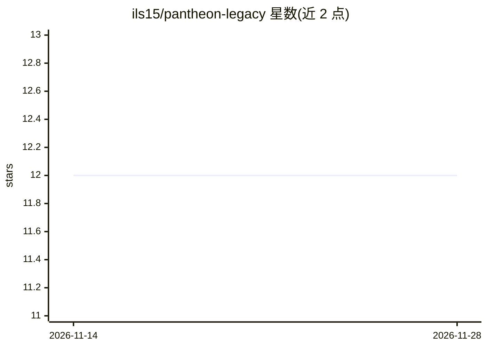

# ils15/pantheon-legacy

⭐ 12 · JavaScript · MIT · 推送 2026-11-14 · [GitHub](https://github.com/ils15/pantheon-legacy) · 个人维护

**以 TDD 驱动软件开发流程的 14 个专用 AI 代理框架**

面向使用 VS Code Copilot、OpenCode、Claude Code、Cursor 等编辑器的开发者，将规划、实现、测试、审查拆分为 14 个专用代理，采用 conductor-delegate 模式：Zeus 编排、Athena 规划、多个代理并行实现、Themis 审计。关键机制为每阶段人工审批门槛与最低 80% 测试覆盖率；本体是配置框架，无自带运行时，代理以 markdown/YAML 形式驻留在编辑器内。原生命令仅限 OpenCode，其他平台用自然语言调用。

## 筛选速览

| 维度 | 判定 | 备注 |
|---|---|---|
| AI 角色 | `ai-ecosystem` | LLM/agent 周边工具 |
| 许可风险 | `permissive` | MIT |
| 部署形态 | `library` | 以包/库形式分发 |
| 模型依赖 | — | README 未给出锁定关系 |
| 硬件要求 | — | 无带数字的原话,不猜 |
| 安装摩擦 | `low` | 无编译、无系统依赖或容器化 |
| 成熟度 | `idea` | |

## 能力要点

- 14 个专用代理的 conductor-delegate 编排模式（规划/实现/审计分离）
- 每阶段人工审批门槛与最低 80% 测试覆盖率要求
- 40 个跨平台 skills 与 10 个领域代码规范
- 无自带运行时，代理以 markdown/YAML 配置驻留编辑器

## 适用场景

- 在编辑器中以多代理流程执行 TDD 开发
- 要求 AI 生成代码必须通过人工审批与测试覆盖才进入下一阶段
- 为多个 AI 编辑器/CLI 工具配置统一的代理工作流

## 场景标签

`编码 Agent` `多智能体` · 领域:Agent 开发

## 证据(README 行号)

> L5: VS Code Copilot, OpenCode, Claude Code, Cursor, Windsurf, Cline ou Continue.dev.
> L23: cobertura mínima de 80% de testes e sem o seu aval. É um framework de configuração —
> L50: nativos existem apenas no OpenCode (`/pantheon-*`); nas demais plataformas use

## 星数曲线

2026-11-14 12 → 2026-11-28 12（+0）

---
*卡片 v1 · prompt 1.4 · 生成 2026-11-18 · 置信度 high · 依据 README sha `21ec3a707090` · [字段定义](../../DATASET.md)*
