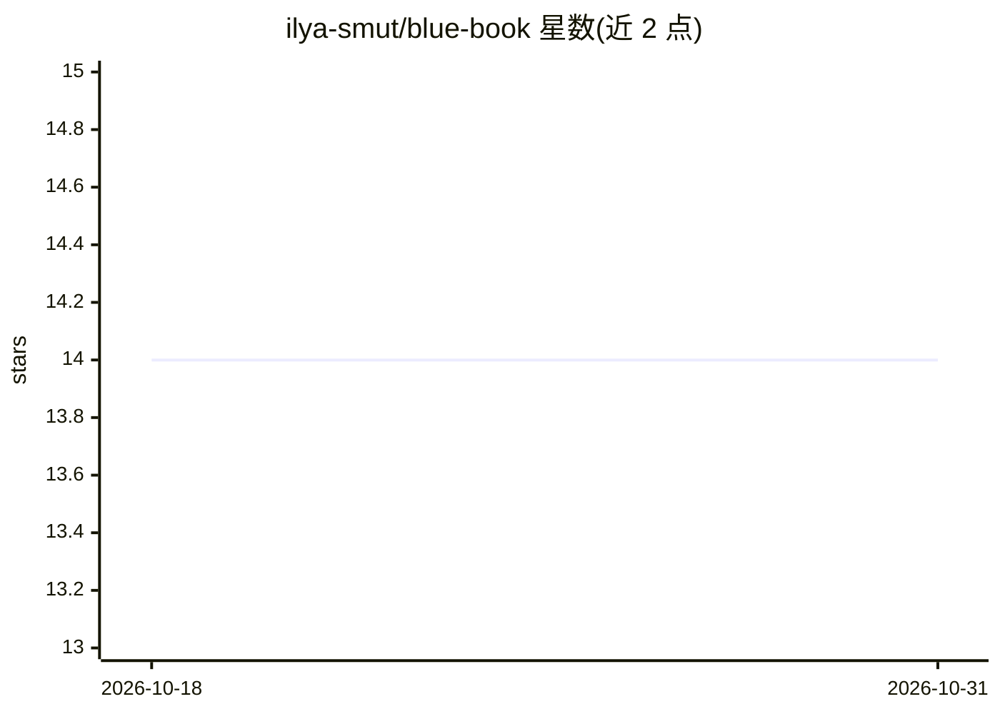

# ilya-smut/blue-book

⭐ 14 · Python · GPL-3.0 · 推送 2026-02-12 · [GitHub](https://github.com/ilya-smut/blue-book) · [官网](https://student-bluebook.notion.site/) · 个人维护

**AI 生成认证考试选择题的 Web 备考工具**

基于 Flask 的 Web 应用，调用 Google Gemini API 为任意考试或认证生成多选题，内置 CompTIA Security+ 预设，可通过 Exam Constructor 添加自定义考试。支持按主题定向出题、逐项解析与即时反馈、个性化学习建议；可上传学习资料同步到 Gemini 远程存储作为出题上下文。数据用 SQLite 持久化，提供 Prompt Builder 自定义模板。首次启动需输入 Gemini API key；免责声明指出题目由第三方模型生成，非官方考试材料。提供 Docker 镜像与 pip 安装两种方式。

## 筛选速览

| 维度 | 判定 | 备注 |
|---|---|---|
| AI 角色 | `ai-native` | 本体是模型或模型工具 |
| 许可风险 | `viral` | GPL-3.0 |
| 部署形态 | `self-host` | docker 或自建部署 |
| 模型依赖 | — | README 未给出锁定关系 |
| 硬件要求 | — | 无带数字的原话,不猜 |
| 安装摩擦 | `low` | 无编译、无系统依赖或容器化 |
| 成熟度 | — | 结构信号不足 |

## 能力要点

- Gemini API 生成任意考试的多选题，附带逐项解析与学习建议
- 内置 CompTIA Security+ 预设，Exam Constructor 可添加自定义考试
- 上传学习资料并同步至 Gemini 远程存储作为出题上下文
- SQLite 持久化保存题目、主题、考试与提示词模板

## 适用场景

- 备考 CompTIA Security+ 等认证时生成练习题并即时获得解析
- 为任意科目或认证自建考试并生成模拟题
- 上传自己的学习笔记让 AI 基于这些材料出题

## 场景标签

 · 领域:教育/考试备考

## 证据(README 行号)

> L5: Blue Book is a web application that generates AI-powered multiple-choice questions for **any exam or certification**
> L12: - Generate multiple-choice questions for any exam using Gemini AI.
> L44: |AI|Google Gemini API (`google-genai`)|

## 星数曲线

2026-10-18 14 → 2026-10-31 14（+0）

---
*卡片 v1 · prompt 1.4 · 生成 2026-10-31 · 置信度 high · 依据 README sha `73523827bb11` · [字段定义](../../DATASET.md)*
