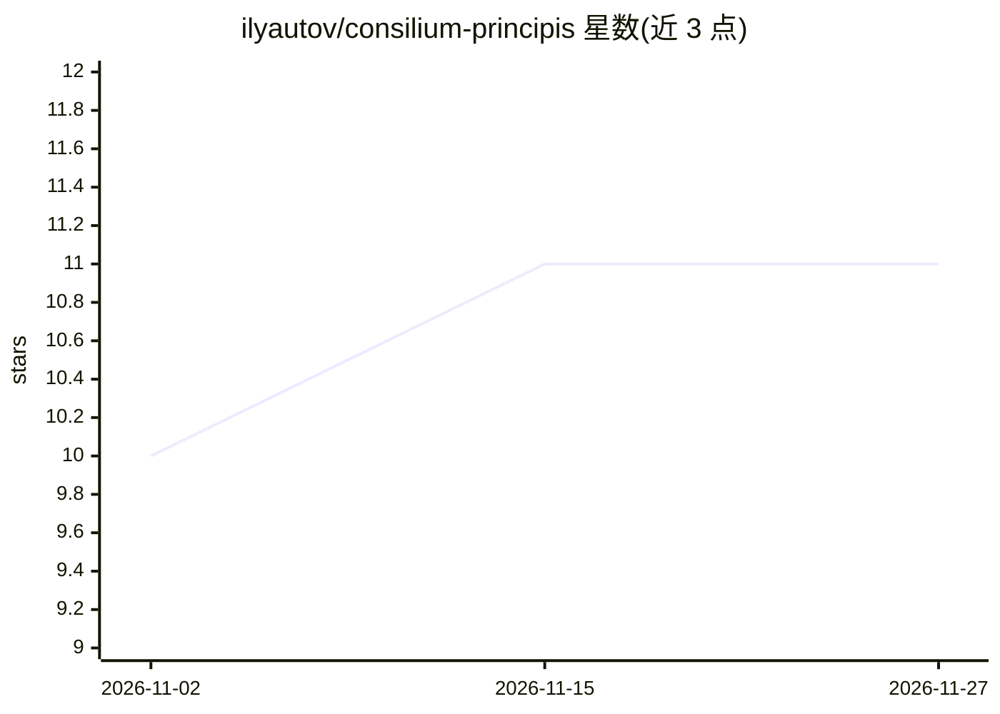

# ilyautov/consilium-principis

⭐ 11 · Python · MIT · 推送 2026-11-26 · [GitHub](https://github.com/ilyautov/consilium-principis) · [官网](https://aifrontier.tech/sistemy/consilium-principis/) · 个人维护 · 中文 README

**面向决策者的 AI 顾问团：多视角会商+逐字引文核验**

以 Claude Code 技能与 MCP 服务器形式提供的决策辅助工具：用户提出难题后，由孙武、马可·奥勒留、马基雅维利等基于公版文本构建的 AI 顾问从各自视角审视、相互辩驳，最终给出一份综合与一个下一步行动。可量化问题可拆解为三点评估并用确定性蒙特卡洛计算。核心机制是 fail-closed 引文核验：逐字引用（🔵）由代码对照原文逐词校验，找不到则拒引。运行于用户已有的 agent，无需单独 API key；支持本地离线模型。

## 筛选速览

| 维度 | 判定 | 备注 |
|---|---|---|
| AI 角色 | `ai-native` | 本体是模型或模型工具 |
| 许可风险 | `permissive` | MIT |
| 部署形态 | `desktop` | 安装包/桌面程序 |
| 模型依赖 | local-ok | 支持本地模型 |
| 硬件要求 | — | 无带数字的原话,不猜 |
| 安装摩擦 | `low` | 无编译、无系统依赖或容器化 |
| 成熟度 | — | 结构信号不足 |

## 能力要点

- 逐字引文由代码对照公版语料逐词核验，核验失败即拒引（fail-closed）
- 🟡/🔵/🟢/📐 保护轮廓标记区分演绎、逐字引用与计算结果
- 量化问题走确定性蒙特卡洛决策图（代码计算，零 LLM 参与）
- 以 Claude Code 插件/skill 与 MCP 服务器两种形态分发

## 适用场景

- 面对多项选择时从多个视角审视并得到一个下一步行动
- 发布前做 premortem 推演潜在失败点
- 对量化取舍（回公司上班还是继续创业）做蒙特卡洛测算
- 引用历史人物观点时确保引文逐字可查证

## 场景标签

 · 领域:决策支持/AI 助手

## 证据(README 行号)

> L9: An AI advisory board for Claude Code and MCP hosts. Ask about a difficult choice: advisors examine it through differ
> L32: **Consilium Principis is a skill and MCP server for AI agents.** You connect it to your agent, ask a
> L37: doesn't eyeball it — it breaks the decision into numbers and runs them through a Monte Carlo.

## 星数曲线

2026-11-02 10 → 2026-11-27 11（+1）

---
*卡片 v1 · prompt 1.4 · 生成 2026-11-18 · 置信度 high · 依据 README sha `7358a6e035de` · [字段定义](../../DATASET.md)*
