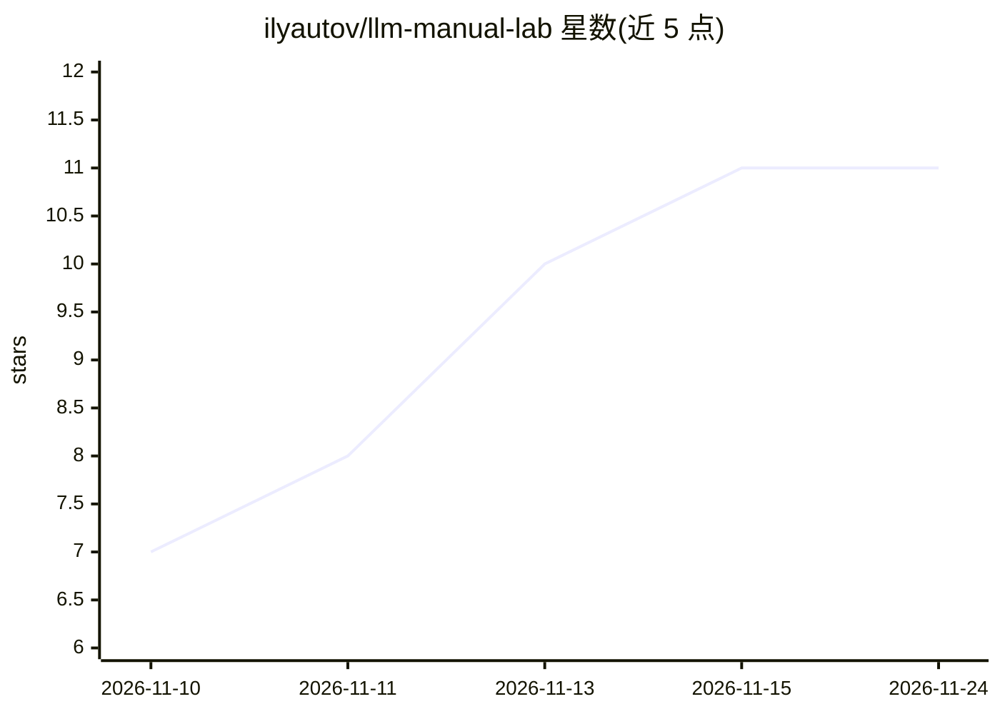

# ilyautov/llm-manual-lab

⭐ 11 · Python · NOASSERTION · 推送 2026-11-09 · [GitHub](https://github.com/ilyautov/llm-manual-lab) · 个人维护

**俄语免费 LLM 理论教材，附 TypeScript 可复现实验室**

82 页俄语免费教材《LLM 理论与 AI 实验室实践》，面向将 LLM 集成到产品中的工程师及需要区分模型与应用职责的管理者/分析师，覆盖模型基础、训练（SFT/RLHF/DPO/LoRA）、推理与应用（KV cache、RAG、agent、prompt injection）、评估共 22 章。附带 TypeScript 实验室：确定性命令无需网络与外部依赖，真实模型实验通过本地 Ollama 进行，数据不出本机。书籍正文 CC BY-NC 4.0，实验室代码 MIT。

## 筛选速览

| 维度 | 判定 | 备注 |
|---|---|---|
| AI 角色 | `ai-knowledge` | 知识聚合/清单类 |
| 许可风险 | `none` | NOASSERTION |
| 部署形态 | `None` |  |
| 模型依赖 | local-ok | 支持本地模型 |
| 硬件要求 | — | 无带数字的原话,不猜 |
| 安装摩擦 | `low` | 无编译、无系统依赖或容器化 |
| 成熟度 | — | 结构信号不足 |

## 能力要点

- 22 章覆盖模型基础、训练、推理应用与评估，附 47 个一手来源
- TypeScript 实验室含 24 个测试，attention/指标等计算由代码生成并验证
- 本地 Ollama 运行真实模型实验（qwen2.5:3b），数据不出本机
- 交互式 HTML 页面可免安装演示温度、因果掩码与 LoRA 秩

## 适用场景

- 系统学习 LLM 原理与训练/推理/评估各环节
- 动手复现 tokenization、attention、RAG、安全策略等实验
- 为产品接入 LLM 时理清模型与应用各自的职责边界

## 场景标签

`教程课程` · 领域:学习与行业

## 证据(README 行号)

> L3: Бесплатный учебник на русском о том, как устроены большие языковые модели и системы вокруг них, с воспроизводимой ла
> L29: ## Лаборатория
> L31: Нужен Node.js 24. Детерминированным командам не нужны сеть и внешние пакеты.

## 星数曲线

2026-11-10 7 → 2026-11-24 11（+4）

---
*卡片 v1 · prompt 1.4 · 生成 2026-11-18 · 置信度 high · 依据 README sha `715ade8b5ed2` · [字段定义](../../DATASET.md)*
