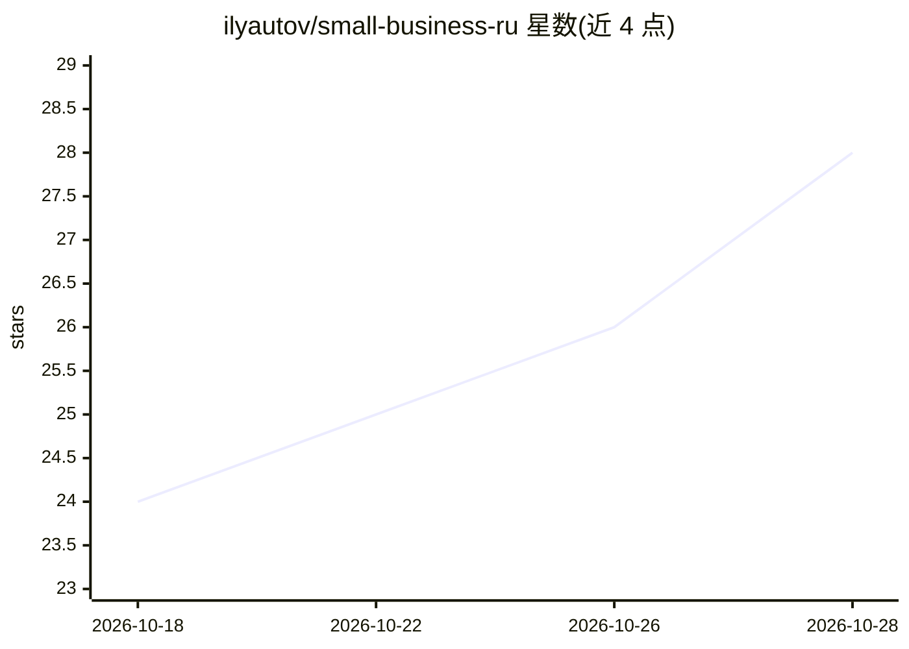

# ilyautov/small-business-ru

⭐ 29 · Python · Apache-2.0 · 推送 2026-09-29 · [GitHub](https://github.com/ilyautov/small-business-ru) · [官网](https://small-business-ru.aifrontier.tech/) · 个人维护

**面向俄罗斯小微企业经营者的 34 个 AI agent 技能包**

基于 Anthropic small-business 技能包本地化为俄罗�斯场景的技能集合：34 个技能覆盖现金流预测、УСН 税务、应收账款、CRM、招聘、合同审查，并新增按 ИНН 核验交易对手（汇总 ЕГРЮЛ/ФССП/仲裁/破产登记数据）、税务日历、多源交叉核验三个本地技能。数值由脚本计算而非模型估算，无数据时标注「未核验」。以 Claude Code 插件、npx skills、SKILL.md 手动安装等方式接入 Claude Code/Cursor/Codex/ChatGPT/Gemini 等多种 agent。自述处于 alpha，税务数字基于 2026 年规范，声明不替代会计师或律师。

## 筛选速览

| 维度 | 判定 | 备注 |
|---|---|---|
| AI 角色 | `ai-ecosystem` | LLM/agent 周边工具 |
| 许可风险 | `permissive` | Apache-2.0 |
| 部署形态 | `library` | 以包/库形式分发 |
| 模型依赖 | locked-api |  |
| 硬件要求 | — | 无带数字的原话,不猜 |
| 安装摩擦 | `low` | 无编译、无系统依赖或容器化 |
| 成熟度 | `idea` | |

## 能力要点

- Anthropic small-business 包 31 个技能全部本地化，另加 3 个俄罗斯专属技能
- counterparty-guard 按 ИНН 汇总多个官方登记处数据并输出风险红绿灯
- 税务与现金流数字由脚本计算并在控制点上校验，无数据时标注「未 проверено」
- 提供 Codex/ChatGPT/Gemini/Cursor 适配器及其他 SKILL.md 兼容 agent 的接入方式

## 适用场景

- 交易前按 ИНН 核验供应商/客户的注册、诉讼与破产记录
- 跟踪 УСН 税务期限并获得脚本计算的应缴金额
- 让 Claude 帮我做现金流预测、应收账款跟进与月末结账

## 场景标签

`提示工程` `网页抓取` · 领域:Agent 开发

## 证据(README 行号)

> L5: > **Чтобы не сойти с ума в своём деле.** 34 открытых AI-скилла под операционку малого бизнеса РФ: деньги, клиенты, н
> L38: - **Числа считаются кодом**, а не прикидываются моделью. Прогноз денежного потока, маржа, налоги УСН считаются скри
> L72: |**small-business-ru**|34 скилла операционки: деньги, УСН-налоги, дебиторка, маржа, CRM, контент, найм, договоры, п

## 星数曲线

2026-10-18 24 → 2026-10-28 28（+4）

---
*卡片 v1 · prompt 1.4 · 生成 2026-10-26 · 置信度 high · 依据 README sha `dfa277117067` · [字段定义](../../DATASET.md)*
