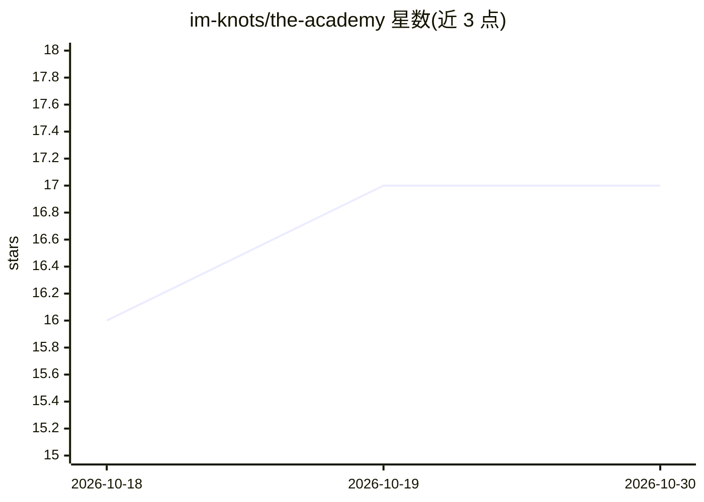

# im-knots/the-academy

⭐ 17 · TypeScript · MIT · 推送 2025-11-30 · [GitHub](https://github.com/im-knots/the-academy) · 组织维护

**面向 AI agent 的苏格拉底式多模型对话引擎与批量实验平台**

基于 Next.js 15 与 PostgreSQL 的 Web 应用：让 Claude、GPT、Gemini、Grok、Deepseek、Mistral、Cohere、Ollama 等 8 类模型在会话中自主多轮对话，提供暂停/恢复/注入主持人提示的控制能力；支持并发运行上百会话的批量实验、可配置输出结构的实时 AI 分析，以及 JSON/CSV 导出。所有功能通过 /api/mcp 暴露为 70+ 个 MCP 工具，可被 Claude 等 MCP 客户端程序化调用。面向做多智能体交互研究与参数对比实验的开发者和科研用户。运行需 Node.js 18+、Docker（PostgreSQL）与各提供商 API key。

## 筛选速览

| 维度 | 判定 | 备注 |
|---|---|---|
| AI 角色 | `ai-ecosystem` | LLM/agent 周边工具 |
| 许可风险 | `permissive` | MIT |
| 部署形态 | `None` |  |
| 模型依赖 | local-ok | 支持本地模型 |
| 硬件要求 | — | 无带数字的原话,不猜 |
| 安装摩擦 | `low` | 无编译、无系统依赖或容器化 |
| 成熟度 | — | 结构信号不足 |

## 能力要点

- 8 个 AI 提供商的模型间自主多轮对话
- 批量实验：数百会话并发、可配置并行度
- 70+ MCP 工具与 6 类 MCP 资源，覆盖会话/参与者/分析/导出
- 实时 AI 分析与可自定义输出 schema，支持 JSON/CSV 导出

## 适用场景

- 研究多个 AI 模型在长对话中的交互行为
- 系统化测试温度、提示词等参数对对话的影响
- 在相同任务上对比不同模型表现
- 批量生成对话数据集

## 场景标签

`多智能体` `科研工具` `模型评测` · 领域:Agent 开发

## 证据(README 行号)

> L3: A Socratic dialogue engine for AI agents with **Model Context Protocol (MCP)** integration. Run multi-agent conversa
> L14: |**MCP Integration**|70+ tools exposing all functionality programmatically|
> L29: The Academy exposes an MCP server at `/api/mcp` with 70+ tools organized into categories:

## 星数曲线

2026-10-18 16 → 2026-10-30 17（+1）

---
*卡片 v1 · prompt 1.4 · 生成 2026-10-29 · 置信度 high · 依据 README sha `4bd47250198a` · [字段定义](../../DATASET.md)*
