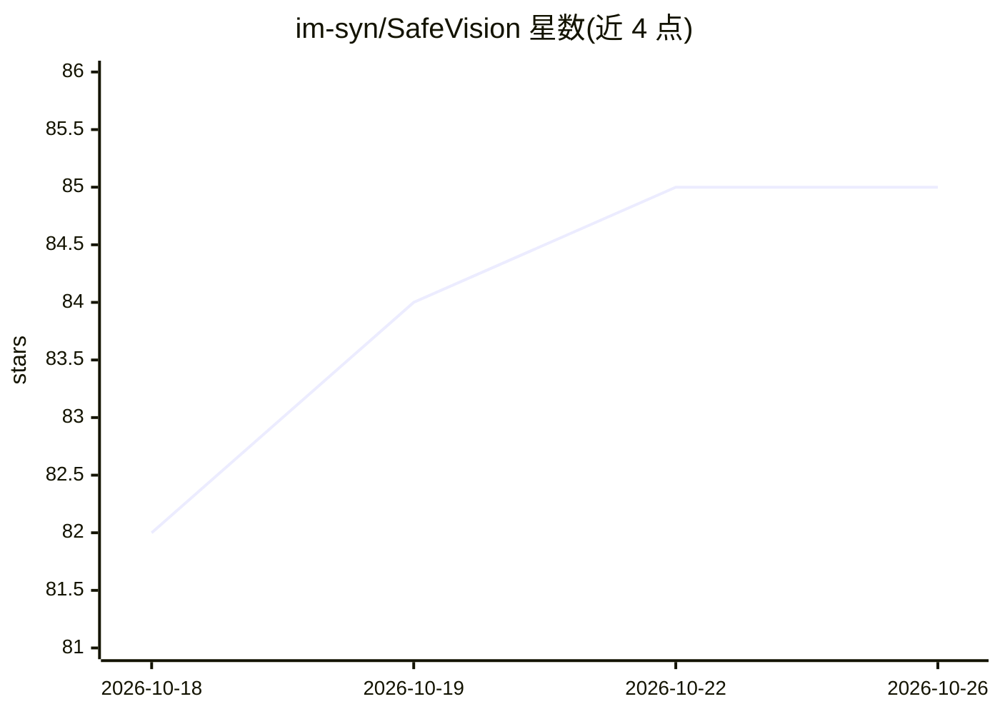

# im-syn/SafeVision

⭐ 85 · Python · Apache-2.0 · 推送 2026-08-31 · [GitHub](https://github.com/im-syn/SafeVision) · 个人维护

**本地 NSFW 检测与打码工具包：处理图片/视频/摄像头/屏幕/API**

基于 ONNX 模型的本地视觉安全工具包，对图片、视频、摄像头、屏幕、直播流与 Web API 执行 NSFW 区域检测、年龄估计与模型报告的性别分类，并按策略规则输出模糊、遮盖等隐私保护渲染。将检测、策略、渲染三层分离，提供 50 个 .rule 模板，输出 JSON/CSV/EDL/FCPXML 报告。接口包括 CLI、桌面 GUI、REST API 与托管 API。README 声明年龄估计非法律年龄验证，儿童准确性可能较低。Screen Guard 含 Windows 特定屏幕捕获支持。

## 筛选速览

| 维度 | 判定 | 备注 |
|---|---|---|
| AI 角色 | `ai-native` | 本体是模型或模型工具 |
| 许可风险 | `permissive` | Apache-2.0 |
| 部署形态 | `desktop` | 安装包/桌面程序 |
| 模型依赖 | — | README 未给出锁定关系 |
| 硬件要求 | — | 无带数字的原话,不猜 |
| 安装摩擦 | `medium` | 含编译或系统依赖之一 |
| 成熟度 | — | 结构信号不足 |

## 能力要点

- NSFW 检测、年龄估计、性别分类三项检查可独立或组合运行
- 检测/策略/渲染三层分离，50 个预制 .rule 模板
- 覆盖 CLI、GUI、摄像头、Screen Guard、OBS 流、REST API 等多种接口
- 输出支持区域模糊、实色遮盖与带文字提示的全覆盖模式

## 适用场景

- 给图片或视频自动检测 NSFW 内容并打码
- 在 CI 上传流程中作为内容审核门禁（--fail-on-policy）
- 用本地摄像头或屏幕做实时内容过滤
- 通过 REST API 集成到自己的内容审核服务

## 场景标签

`目标检测` `图像视频处理` · 领域:感知与多模态

## 证据(README 行号)

> L7:  Local-first visual safety for images, video, cameras, screens, streams, and web APIs.
> L8:  Run NSFW detection, estimated-age review, model-reported gender classification, policy evaluation, and privacy-safe
> L46:  🧠 Three checks

## 星数曲线

2026-10-18 82 → 2026-10-26 85（+3）

---
*卡片 v1 · prompt 1.4 · 生成 2026-10-24 · 置信度 high · 依据 README sha `069d6870e27d` · [字段定义](../../DATASET.md)*
