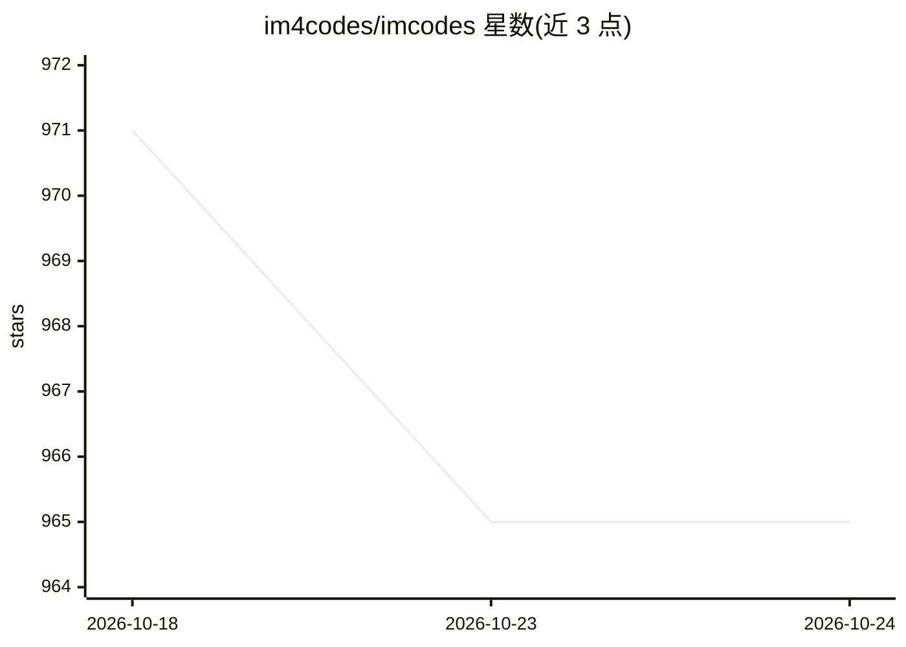

# im4codes/imcodes

⭐ 965 · TypeScript · MIT · 推送 2026-10-24 · [GitHub](https://github.com/im4codes/imcodes) · [官网](https://im.codes) · 个人维护 · 中文 README

**面向编码代理的即时通讯层：共享记忆、监督执行与跨代理审计**

IM.codes 是围绕终端编码代理的消息、记忆与审查层：将受管机器注册为受限 Controlled Nodes，让授权代理执行范围化命令、文件传输与类型化 Computer Use，支持浏览器远程桌面。跨 Claude Code、Codex、Gemini CLI、Cursor 等提供共享上下文与记忆层、daemon 管理的 stdio MCP 工具面（记忆读写、代理间消息、cron 调度）、逐轮监督执行（off/supervised/supervised_audit 三模式）与 OpenSpec Auto Deliver 端到端交付流水线。原始与处理后记忆保持本地，处理后摘要可选择性云同步。作者声明为个人项目，无 SLA 与稳定性保证；企业共享记忆仍在开发中。

## 筛选速览

| 维度 | 判定 | 备注 |
|---|---|---|
| AI 角色 | `ai-ecosystem` | LLM/agent 周边工具 |
| 许可风险 | `permissive` | MIT |
| 部署形态 | `self-host` | docker 或自建部署 |
| 模型依赖 | — | README 未给出锁定关系 |
| 硬件要求 | — | 无带数字的原话,不猜 |
| 安装摩擦 | `low` | 无编译、无系统依赖或容器化 |
| 成熟度 | `idea` | |

## 能力要点

- 跨提供方的共享代理上下文与记忆层（本地存储、可选云同步、多语言向量召回）
- 受管 MCP 工具面：记忆检索/写入、代理间消息、cron 调度，运行时绑定身份与安全门控
- 逐轮监督执行：空闲边界分类 complete/continue/ask_human，fail-closed 自动化
- OpenSpec Auto Deliver：提案审查、实现循环、模块化评分与 rework 门禁

## 适用场景

- 离开工位后从手机/网页继续查看和操控终端里的编码代理会话
- 在多个 AI 提供方的代理间共享项目记忆与上下文
- 让监督代理自动驱动多轮实现并进行跨模型审计
- 把多台电脑注册为节点，由代理远程执行命令与文件操作

## 场景标签

`编码 Agent` `Agent 记忆` · 领域:Agent 开发

## 证据(README 行号)

> L13: Alongside machine control, IM.codes gives coding agents one shared memory layer and one managed MCP tool surface ac
> L52: It is not another AI IDE or a generic remote terminal. It is the messaging, memory, and review layer around termina
> L83: IM.codes exposes a daemon-managed stdio MCP server to supported SDK-backed providers. Agents get one runtime-scoped

## 星数曲线

2026-10-18 971 → 2026-10-24 965（-6）

---
*卡片 v1 · prompt 1.4 · 生成 2026-10-21 · 置信度 mid · 依据 README sha `d6eab7485c5e` · [字段定义](../../DATASET.md)*
