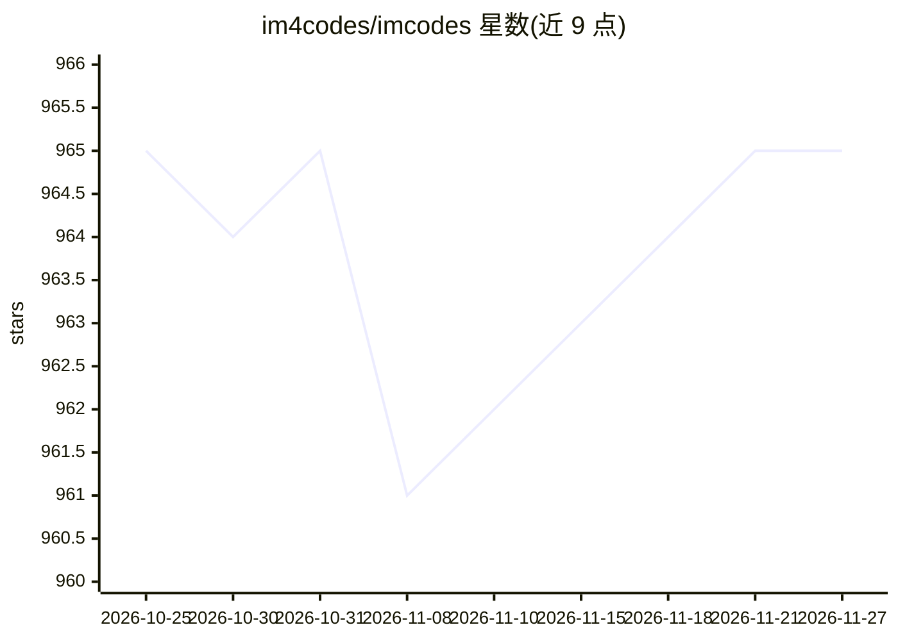

# im4codes/imcodes

⭐ 965 · TypeScript · NOASSERTION · 推送 2026-11-26 · [GitHub](https://github.com/im4codes/imcodes) · [官网](https://im.codes) · 个人维护

**给 coding agent 的 IM：共享记忆、受监督执行与跨 agent 审计**

IM.codes 将终端编码 agent 接入消息层：把受支持的机器注册为受限 Controlled Nodes，由授权 agent 执行范围化命令、文件传输与 Computer Use 操作，Windows 节点可提供浏览器远程桌面。为 Claude Code、Codex、Gemini CLI 等多个 provider 提供共享记忆层与托管 MCP 工具面，将已完成工作转为可复用上下文；提供 OpenSpec 变更的端到端监督交付流水线（审计评分、返工门控）、逐轮 Auto 监督与跨 provider Team 审计。定位为消息、记忆与评审层，非 AI IDE。README 声明为个人开发中的 source-available 项目，无 SLA 与稳定性保证。

## 筛选速览

| 维度 | 判定 | 备注 |
|---|---|---|
| AI 角色 | `ai-ecosystem` | LLM/agent 周边工具 |
| 许可风险 | `none` | NOASSERTION |
| 部署形态 | `self-host` | docker 或自建部署 |
| 模型依赖 | — | README 未给出锁定关系 |
| 硬件要求 | — | 无带数字的原话,不猜 |
| 安装摩擦 | `low` | 无编译、无系统依赖或容器化 |
| 成熟度 | `idea` | |

## 能力要点

- Controlled Nodes：一台或多台机器由授权 agent 范围化操作，Windows 节点支持浏览器远程桌面
- 共享记忆层：完成工作转为问题→解法记忆，多语言 pgvector 召回并自动注入会话
- 托管 stdio MCP 服务器：memory/agent 消息/cron 调度等工具面，运行时绑定身份与 kill switch
- OpenSpec Auto Deliver 与 supervised_audit：结构化评分与 PASS/REWORK/BLOCKED 返工门控

## 适用场景

- 离开工位后从手机/网页继续查看与推进终端里运行的编码 agent
- 让多个 agent 在自己基础设施上协作并共享项目记忆
- 对 OpenSpec 变更跑一键监督交付与实现审计
- 团队对即将合入的代码做跨模型评审与审计

## 场景标签

`编码 Agent` `Agent 记忆` · 领域:Agent 开发

## 证据(README 行号)

> L13: Alongside machine control, IM.codes gives coding agents one shared memory layer and one managed MCP tool surface ac
> L83: IM.codes exposes a daemon-managed stdio MCP server to supported SDK-backed providers. Agents get one runtime-scoped

## 星数曲线

2026-10-25 965 → 2026-11-27 965（+0）

---
*卡片 v1 · prompt 1.4 · 生成 2026-11-27 · 置信度 mid · 依据 README sha `e0905dcfc5cd` · [字段定义](../../DATASET.md)*
