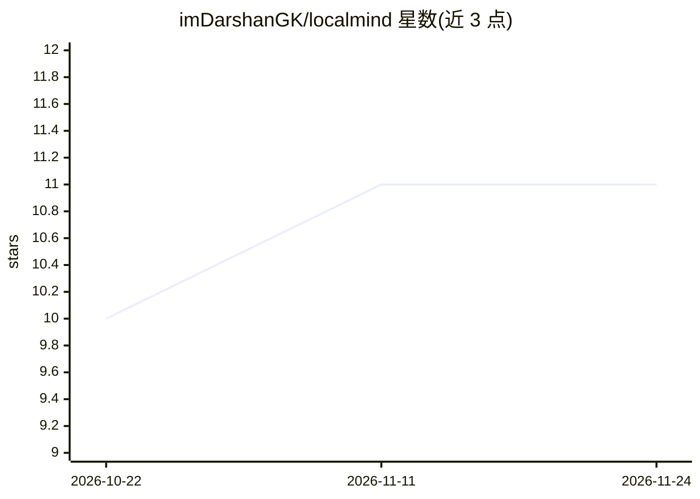

# imDarshanGK/localmind

⭐ 11 · JavaScript · MIT · 推送 2026-08-01 · [GitHub](https://github.com/imDarshanGK/localmind) · [官网](https://localmind-chat.vercel.app) · 个人维护

**本地离线文档问答助手：无云端、无 API key**

基于 FastAPI + React + Ollama + LangChain 的本地 RAG 应用：上传 PDF/TXT/CSV/DOCX/MD/HTML 文档后可对话问答，检索由 all-MiniLM-L6-v2 嵌入加 ChromaDB 实现，模型经本地 Ollama 运行，数据不离开本机。提供流式响应、6 个插件、8 界面语言、会话管理与 Markdown/JSON/TXT 导出。Docker Compose 一键部署，也可手动安装前后端；需预装 Python 3.11+、Node 18+ 与 Ollama 并拉取约 4GB 模型。

## 筛选速览

| 维度 | 判定 | 备注 |
|---|---|---|
| AI 角色 | `ai-native` | 本体是模型或模型工具 |
| 许可风险 | `permissive` | MIT |
| 部署形态 | `self-host` | docker 或自建部署 |
| 模型依赖 | local-ok | 支持本地模型 |
| 硬件要求 | — | 无带数字的原话,不猜 |
| 安装摩擦 | `low` | 无编译、无系统依赖或容器化 |
| 成熟度 | — | 结构信号不足 |

## 能力要点

- 本地 RAG 文档问答，嵌入与向量库均在本地运行
- 多模型支持：Llama3、Mistral、Phi3、Gemma、DeepSeek
- 插件系统与插件执行审计日志
- Docker Compose 部署与 Render/Vercel 部署配置

## 适用场景

- 在无法联网或涉密环境中查询自己的文档
- 给家人朋友搭一个不外传数据的本地问答助手
- 在笔记本上离线运行一个文档 RAG 演示

## 场景标签

`文档问答` · 领域:知识与检索

## 证据(README 行号)

> L2: ### Offline AI Assistant - Chat with Your Documents. Privately.
> L37: |RAG — Chat with Documents|Included|

## 星数曲线

2026-10-22 10 → 2026-11-24 11（+1）

---
*卡片 v1 · prompt 1.4 · 生成 2026-11-18 · 置信度 mid · 依据 README sha `3e9f708b79eb` · [字段定义](../../DATASET.md)*
