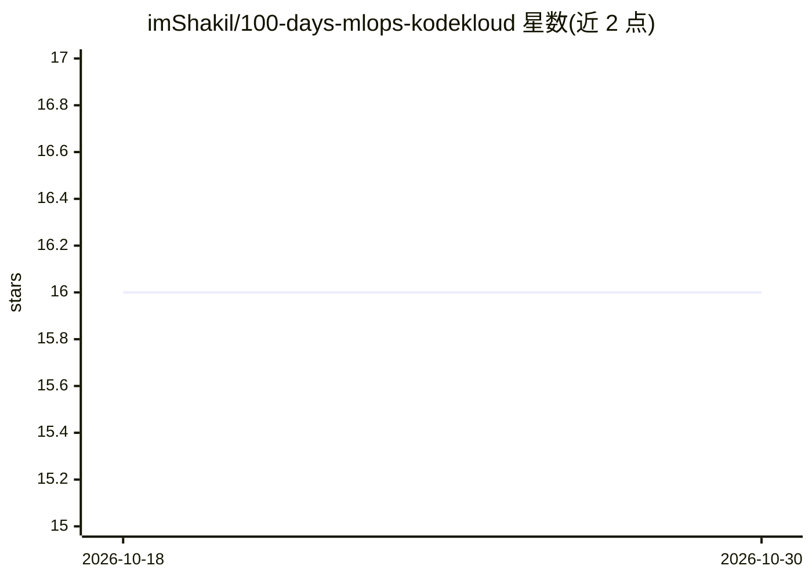

# imShakil/100-days-mlops-kodekloud

⭐ 16 · Python · GPL-3.0 · 推送 2026-08-11 · [GitHub](https://github.com/imShakil/100-days-mlops-kodekloud) · [官网](http://mhosen.com/100-days-mlops-kodekloud/) · 个人维护

**KodeKloud 100 天 MLOps 挑战的代码与解答仓库**

KodeKloud 100 Days of MLOps 课程的配套仓库，收录 100 个按天递进的动手挑战及解答：从 Python 环境与项目结构、DVC 数据版本控制、MLflow 实验跟踪与模型注册，到 Docker 容器化、Flask/FastAPI/BentoML 模型服务、Prometheus/Grafana/Evidently 监控、CI/CD 以及 Argo/Prefect/KServe/Kubeflow 的 Kubernetes 部署。README 显示进度约 34%，前 34 天标记为已解决。要求读者具备 Python、Git 与基础机器学习知识。

## 筛选速览

| 维度 | 判定 | 备注 |
|---|---|---|
| AI 角色 | `ai-knowledge` | 知识聚合/清单类 |
| 许可风险 | `viral` | GPL-3.0 |
| 部署形态 | `self-host` | docker 或自建部署 |
| 模型依赖 | — | README 未给出锁定关系 |
| 硬件要求 | — | 无带数字的原话,不猜 |
| 安装摩擦 | `low` | 无编译、无系统依赖或容器化 |
| 成熟度 | `idea` | |

## 能力要点

- 100 个挑战覆盖 DVC、MLflow、Docker、监控、CI/CD、Kubernetes 全链路
- 每项挑战列出主题标签与解答状态
- 包含 4 个端到端综合项目（Capstone）
- 前 34 天解答已完成，进度约 34%

## 适用场景

- 系统学习并练习 MLOps 工具链
- 查找 DVC/MLflow/Kubernetes 等具体任务的参考解答
- 按 100 天计划打卡跟进学习进度

## 场景标签

`教程课程` `MLOps` · 领域:学习与行业

## 证据(README 行号)

> L3: This repository contains the code and resources for the **100 Days of MLOps** challenge by KodeKloud. The course is 
> L12: This challenge walks through core MLOps practice end to end. You start with local Python setup, project structure, 

## 星数曲线

2026-10-18 16 → 2026-10-30 16（+0）

---
*卡片 v1 · prompt 1.4 · 生成 2026-10-30 · 置信度 mid · 依据 README sha `9561df097597` · [字段定义](../../DATASET.md)*
