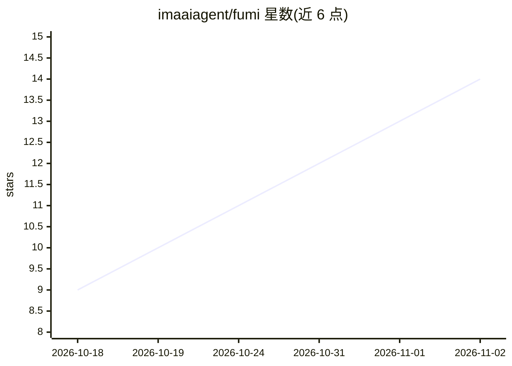

# imaaiagent/fumi

⭐ 14 · C++ · NOASSERTION · 推送 2026-10-15 · [GitHub](https://github.com/imaaiagent/fumi) · [官网](https://fumi.codes/) · 个人维护

**桌搭开源 AI 伙伴：ESP32-S3 实体电子宠物，可对话**

基于 ESP32-S3（Waveshare 1.46 寸触控屏）与 LVGL 的开源桌面 AI 伴侣设备：固件提供动画角色 UI、触控交互、饥饿/能量/快乐等虚拟宠物机制、小游戏与按键说话的语音输入；对话与语音转文字由 Node.js 后端代理，通过适配器式配置接入 OpenAI、Anthropic Claude、xAI Grok、OpenRouter、Ollama 或 OpenAI 兼容 API。API key 不写入固件。面向自行组装硬件的创客与开发者，需 Arduino IDE 编译或从 GitHub Actions 下载固件产物，项目自述为 active/experimental，硬件与 provider 支持仅限明确标注部分。

## 筛选速览

| 维度 | 判定 | 备注 |
|---|---|---|
| AI 角色 | `ai-native` | 本体是模型或模型工具 |
| 许可风险 | `none` | NOASSERTION |
| 部署形态 | `library` | 以包/库形式分发 |
| 模型依赖 | local-ok | 支持本地模型 |
| 硬件要求 | — | 无带数字的原话,不猜 |
| 安装摩擦 | `low` | 无编译、无系统依赖或容器化 |
| 成熟度 | `idea` | |

## 能力要点

- 适配器式后端配置，支持 OpenAI/Anthropic/xAI/OpenRouter/Ollama 及 OpenAI 兼容 API
- 动画角色 UI、触控交互与虚拟宠物状态机制（hunger/energy/bond 等）
- push-to-talk 语音输入与可插拔 speech-to-text 适配器
- 提供浏览器 demo（demo/index.html）免硬件测试后端

## 适用场景

- 创客自制带 AI 对话能力的桌面电子宠物
- 用自己喜欢的模型（含 Ollama 本地模型）驱动实体硬件设备
- 不依赖实体设备先在浏览器里测试后端对话链路

## 场景标签

`聊天机器人` · 领域:对话与助手

## 证据(README 行号)

> L10: An open-source, Tamagotchi-inspired AI companion for your desk, built on ESP32-S3.
> L21: - cloud AI chat
> L25: **FUMI is not locked to one model provider.** The same firmware can talk to a backend configured for OpenAI, Anthro

## 星数曲线

2026-10-18 9 → 2026-11-02 14（+5）

---
*卡片 v1 · prompt 1.4 · 生成 2026-10-31 · 置信度 high · 依据 README sha `42149bc306b9` · [字段定义](../../DATASET.md)*
