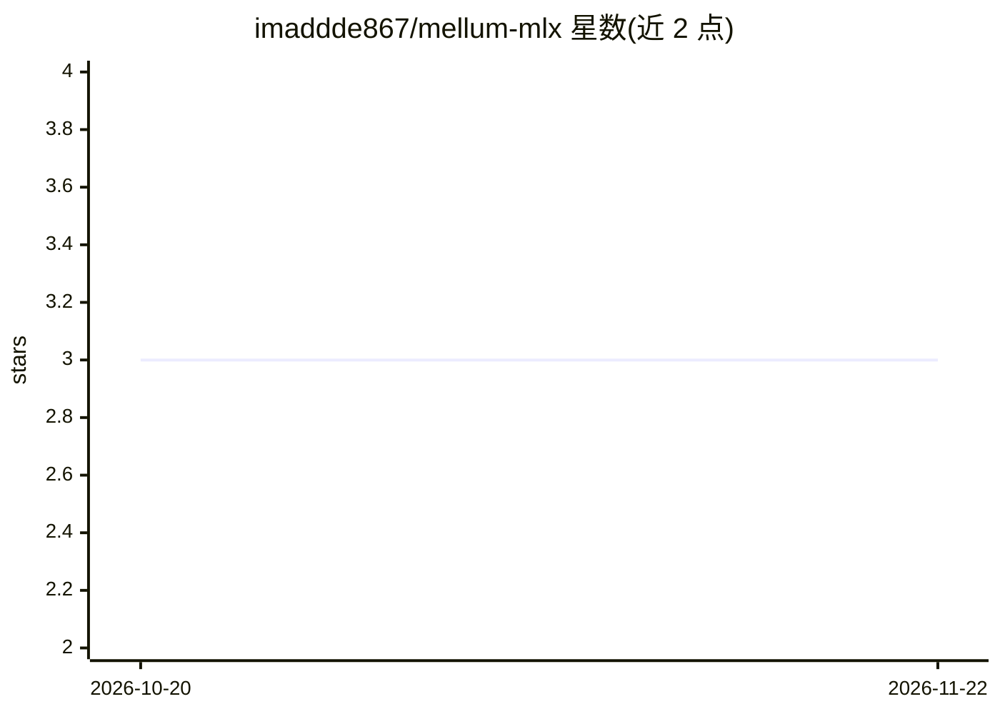

# imaddde867/mellum-mlx

⭐ 3 · Python · MIT · 推送 2026-10-28 · [GitHub](https://github.com/imaddde867/mellum-mlx) · [官网](https://huggingface.co/imaadd05/Mellum2.1-12B-A2.5B-Thinking-mlx-nvfp4) · 个人维护

**面向 Apple Silicon 的 Mellum2.1 思维模型 MLX 量化版本与基准**

将 JetBrains 的 Mellum2.1-12B-A2.5B-Thinking（12B MoE、2.5B 激活参数的代码模型）转制为 MLX 格式的 NVFP4 与 6-bit 两个量化版本，分别面向 16 GB 与 24 GB 以上内存的 Mac。仓库附完整 164 任务 HumanEval+ 基准结果、原始输出、SHA-256 校验和与转制脚本；在 16 GB M4 MacBook Pro 上测量解码速度。提供 mlx-lm 的 Quickstart 命令与可复现评测流程。

## 筛选速览

| 维度 | 判定 | 备注 |
|---|---|---|
| AI 角色 | `ai-native` | 本体是模型或模型工具 |
| 许可风险 | `permissive` | MIT |
| 部署形态 | `library` | 以包/库形式分发 |
| 模型依赖 | — | README 未给出锁定关系 |
| 硬件要求 | — | 无带数字的原话,不猜 |
| 安装摩擦 | `medium` | 含编译或系统依赖之一 |
| 成熟度 | — | 结构信号不足 |

## 能力要点

- NVFP4（6.84 GB，面向 16 GB Mac）与 6-bit（9.87 GB，面向 24 GB+）两种 MLX 构建
- 完整 HumanEval+ 164 任务基准及 M4 解码速度测量数据
- 提供转制、生成、评测脚本与 receipts（记录版本与校验和）
- 附带 MLX-LM 工具调用解析问题的补丁（patches/）

## 适用场景

- 在 16 GB/24 GB 内存的 Apple Silicon Mac 上本地运行 Mellum 代码模型
- 对比各量化版本在 HumanEval+ 上的得分与解码速度
- 复现或扩展量化模型的评测流程

## 场景标签

`模型量化` `模型评测` `推理引擎` · 领域:评测与运维

## 证据(README 行号)

> L3: MLX builds of JetBrains' Mellum2.1-12B-A2.5B-Thinking, a 12B mixture-of-experts coding model with 2.5B active parame
> L14: pip install 'mlx-lm==0.32.0'

## 星数曲线

2026-10-20 3 → 2026-11-22 3（+0）

---
*卡片 v1 · prompt 1.4 · 生成 2026-11-21 · 置信度 high · 依据 README sha `60958d012ab5` · [字段定义](../../DATASET.md)*
