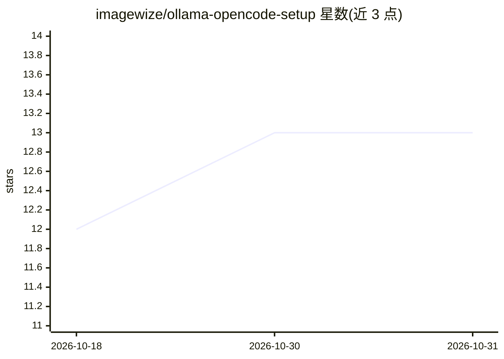

# imagewize/ollama-opencode-setup

⭐ 13 · Shell · MIT · 推送 2026-07-10 · [GitHub](https://github.com/imagewize/ollama-opencode-setup) · 个人维护

**Apple Silicon 上用本地 Ollama 模型运行 OpenCode CLI 的配置与文档集**

面向使用 OpenCode CLI 的开发者的配置仓库：提供 opencode.json 配置、可复现的 Modelfile 上下文变体、工具调用测试脚本与测试套件，配套项目接入、模型选择、上下文窗口、GPU 内存调优等文档。在 M1 16GB 与 M4 Pro 24GB 上实测多款 Ollama 模型，标注各模型的工具调用能力（可写文件或只读）、大小、上下文与速度表现。不含模型本身，需自行安装 Ollama 与 OpenCode CLI 作为前置。

## 筛选速览

| 维度 | 判定 | 备注 |
|---|---|---|
| AI 角色 | `ai-ecosystem` | LLM/agent 周边工具 |
| 许可风险 | `permissive` | MIT |
| 部署形态 | `None` |  |
| 模型依赖 | local-ok | 支持本地模型 |
| 硬件要求 | — | 无带数字的原话,不猜 |
| 安装摩擦 | `low` | 无编译、无系统依赖或容器化 |
| 成熟度 | — | 结构信号不足 |

## 能力要点

- 提供 opencode.json 配置与可复现 Modelfile（32k/16k 上下文变体）
- M1 16GB 与 M4 Pro 24GB 实测 17 个 Ollama 模型并标注工具调用能力
- scripts/tool-call-test.sh 验证模型的工具调用能力
- 示例含代码审查、重构、多文件分析、批处理提示词

## 适用场景

- 在 Mac 上把 OpenCode CLI 接到本地 Ollama 模型
- 按内存大小挑选支持工具调用的本地模型
- 创建 32k 上下文的模型变体以扩大代码分析窗口

## 场景标签

 · 领域:开发者工具/本地 LLM 配置

## 证据(README 行号)

> L3: Configuration and documentation for running Open Code CLI with local Ollama models on Apple Silicon (M-series) Macs.
> L33: |`opencode.json`|Open Code configuration — all tested Ollama models|

## 星数曲线

2026-10-18 12 → 2026-10-31 13（+1）

---
*卡片 v1 · prompt 1.4 · 生成 2026-10-31 · 置信度 high · 依据 README sha `385216382253` · [字段定义](../../DATASET.md)*
