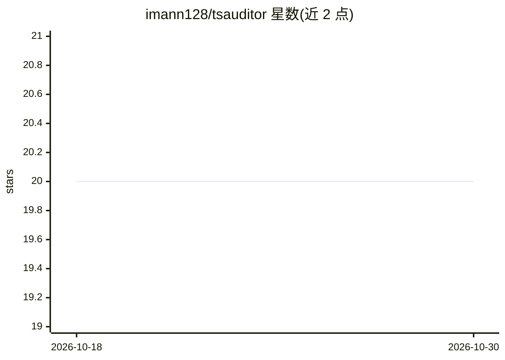

# imann128/tsauditor

⭐ 20 · Python · MIT · 推送 2026-10-27 · [GitHub](https://github.com/imann128/tsauditor) · [官网](https://tsauditor.readthedocs.io/en/stable/) · 个人维护

**时序表格数据质量审计库：检测特征泄漏与异常**

面向金融与传感器场景的时间序列 DataFrame 数据质量审计 Python 库。scan() 对结构问题、异常与特征-目标数据泄漏执行 20+ 项检查（PRF/ANO/LEK001-005/VAL/PNL 模块），其中泄漏检测为核心贡献：基于秩相关、AUC 分离、正滞后互相关与滚动窗口前瞻等机制识别泄漏特征。支持声明式 available_at 发布时间与 constraints 域约束，可在副本上按报告修复问题、计算数据健康分并导出 JSON/PDF 报告。项目源于巴基斯坦股票 OGDC 方向预测模型的真实泄漏 bug 案例。

## 筛选速览

| 维度 | 判定 | 备注 |
|---|---|---|
| AI 角色 | `ai-ecosystem` | LLM/agent 周边工具 |
| 许可风险 | `permissive` | MIT |
| 部署形态 | `library` | 以包/库形式分发 |
| 模型依赖 | — | README 未给出锁定关系 |
| 硬件要求 | — | 无带数字的原话,不猜 |
| 安装摩擦 | `low` | 无编译、无系统依赖或容器化 |
| 成熟度 | — | 结构信号不足 |

## 能力要点

- 20+ 项检查覆盖结构、异常、泄漏、域约束与面板问题，按严重度分级
- 泄漏检测含目标等价、正滞后互相关、滚动前瞻、as-of 发布时点与组合泄漏五类
- 报告驱动的安全修复：副本上操作、异常置 NaN 插值、目标标签不修复
- 数据健康分与 JSON/PDF（可选 extras）正式报告导出

## 适用场景

- 建模前审计时序特征集是否存在目标泄漏
- 为 CPI 等宏观指标声明发布时点，检测 as-of 泄漏
- 对传感器遥测数据做卡值、断点、尖峰等异常检查
- 审计后导出带健康分与前后对比的正式报告

## 场景标签

 · 领域:数据科学/数据质量工具

## 证据(README 行号)

> L8: A data-quality auditing library for **time-series tabular data**, with a focus on
> L10: structured report of structural problems, anomalies, and **data-leakage** between
> L11: features and the prediction target, its core contribution. It can also *repair*

## 星数曲线

2026-10-18 20 → 2026-10-30 20（+0）

---
*卡片 v1 · prompt 1.4 · 生成 2026-10-28 · 置信度 high · 依据 README sha `efead7cdd344` · [字段定义](../../DATASET.md)*
