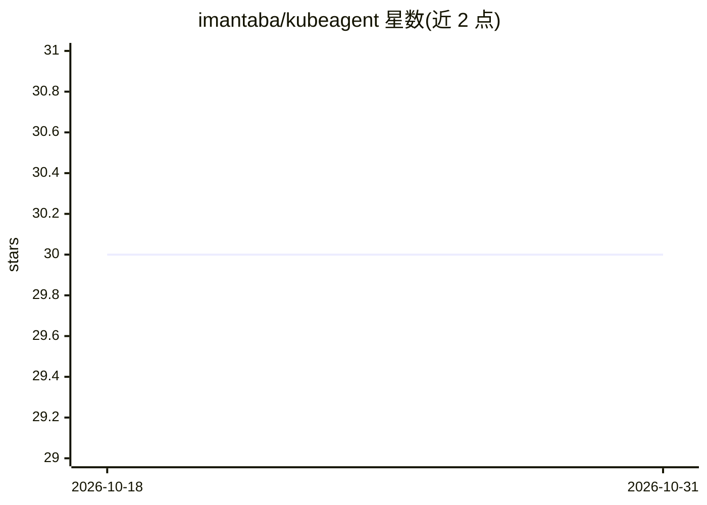

# imantaba/kubeagent

⭐ 30 · Go · Apache-2.0 · 推送 2026-10-06 · [GitHub](https://github.com/imantaba/kubeagent) · [官网](https://k8sproject.top) · 个人维护

**只读 Kubernetes 故障诊断 CLI：解释 Pod 为什么坏及根因**

基于 client-go 的单二进制 Kubernetes 诊断工具，扫描集群中不健康的 Pod 与工作负载，覆盖 CrashLoopBackOff、OOMKilled、RolloutStuck、PDB 阻塞、HPA 卡死、准入 webhook 故障等数十种故障模式，输出含根因归因的报告；另提供 watch 常驻守护进程（Prometheus 指标）、MCP server、CI/CD 门禁与 TUI。默认只读且离线（仅 get/list/watch），可选 --fix 应用受白名单限制的可逆修复；AI 严格可选：--explain 调用一次 Claude API 总结结果，--investigate 提供有界 agentic 只读追查（仅 Anthropic）。面向 SRE 与平台运维人员。

## 筛选速览

| 维度 | 判定 | 备注 |
|---|---|---|
| AI 角色 | `ai-enhanced` | 去掉 AI 部分产品仍成立 |
| 许可风险 | `permissive` | Apache-2.0 |
| 部署形态 | `library` | 以包/库形式分发 |
| 模型依赖 | locked-api |  |
| 硬件要求 | — | 无带数字的原话,不猜 |
| 安装摩擦 | `low` | 无编译、无系统依赖或容器化 |
| 成熟度 | — | 结构信号不足 |

## 能力要点

- 数十种 Pod/工作负载/节点故障模式的确定性诊断与根因归因
- 默认只读离线，无需 API key；可选白名单可逆修复 --fix
- watch 守护进程输出 Prometheus 指标与 /issues 只读端点
- MCP server 与 CI/CD 门禁（退出码契约 + SARIF 渲染）

## 适用场景

- 排查 CrashLoopBackOff、ImagePullBackOff 等常见 Pod 故障的根因
- 在 CI/CD 流水线中以退出码门禁阻断问题部署
- 常驻集群持续诊断并接入 Prometheus 告警
- 通过 MCP 让其他 AI agent 调用诊断能力

## 场景标签

 · 领域:云原生/DevOps 运维

## 证据(README 行号)

> L17: - 📴 **Deterministic & offline** — the whole diagnostic core needs no API key. AI is strictly opt-in.
> L18: - 🤖 **Optional `--explain`** — one Claude API call summarizes findings in plain English (never sends pod specs, env

## 星数曲线

2026-10-18 30 → 2026-10-31 30（+0）

---
*卡片 v1 · prompt 1.4 · 生成 2026-10-26 · 置信度 high · 依据 README sha `389ba3bea7a2` · [字段定义](../../DATASET.md)*
