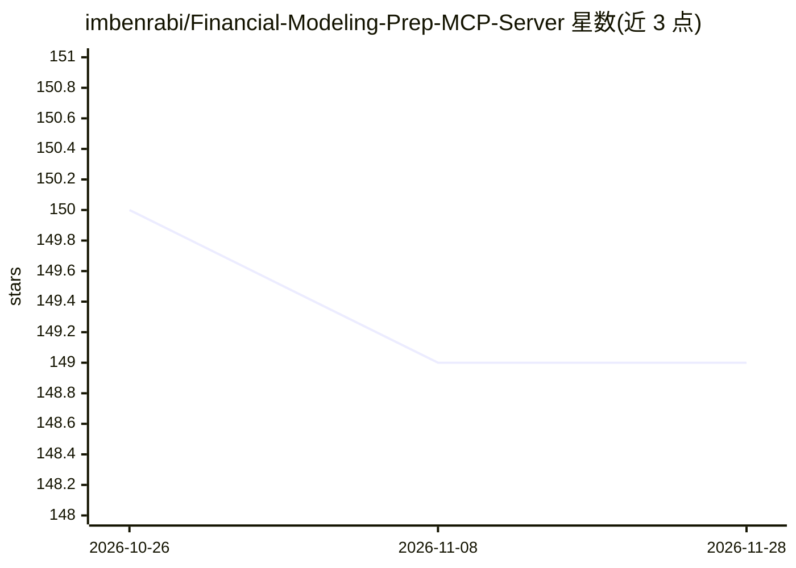

# imbenrabi/Financial-Modeling-Prep-MCP-Server

⭐ 149 · TypeScript · Apache-2.0 · 推送 2026-11-05 · [GitHub](https://github.com/imbenrabi/Financial-Modeling-Prep-MCP-Server) · 个人维护

**面向 AI 助手的 Financial Modeling Prep 财经数据 MCP 服务器**

将 Financial Modeling Prep API 封装为 MCP 服务器，向 AI 助手暴露 267 个财经数据工具，覆盖股票、ETF、加密货币、外汇、大宗商品、财报、SEC 文件、内部人与机构交易等 24 个工具集。支持 Dynamic（5 个元工具按需加载）、Static、All Tools 三种运行模式，可经流式 HTTP 连接 Claude.ai/Claude Desktop 或自定义客户端；提供托管实例，也可通过 npm、Docker（源码构建）或源码自托管。使用需自备 FMP API key。

## 筛选速览

| 维度 | 判定 | 备注 |
|---|---|---|
| AI 角色 | `ai-ecosystem` | LLM/agent 周边工具 |
| 许可风险 | `permissive` | Apache-2.0 |
| 部署形态 | `library` | 以包/库形式分发 |
| 模型依赖 | — | README 未给出锁定关系 |
| 硬件要求 | — | 无带数字的原话,不猜 |
| 安装摩擦 | `low` | 无编译、无系统依赖或容器化 |
| 成熟度 | — | 结构信号不足 |

## 能力要点

- 267 个财经数据工具，覆盖 24 个工具集
- Dynamic/Static/All Tools 三种服务器模式，支持运行时启停工具集
- 流式 HTTP 传输，兼容 Claude.ai 与 Claude Desktop
- 提供托管实例与 npm/Docker/源码自托管方式

## 适用场景

- 让 Claude 等 AI 助手读取公司基本面与财务报表
- 查询股价行情、市场指数与新闻
- 批量获取 ETF、加密货币与外汇数据做分析

## 场景标签

`金融量化` · 领域:学习与行业

## 证据(README 行号)

> L9: A Model Context Protocol (MCP) server for the Financial Modeling Prep API, exposing 267 financial data tools to AI a
> L15: - **Three Server Modes** — Dynamic (5 meta-tools), Static (pre-loaded toolsets), or All Tools (default)
> L16: - **Flexible Deployment** — use the hosted instance or self-host via npm, Docker (built from source), or source

## 星数曲线

2026-10-26 150 → 2026-11-28 149（-1）

---
*卡片 v1 · prompt 1.4 · 生成 2026-11-27 · 置信度 high · 依据 README sha `a199b8ce8ea5` · [字段定义](../../DATASET.md)*
