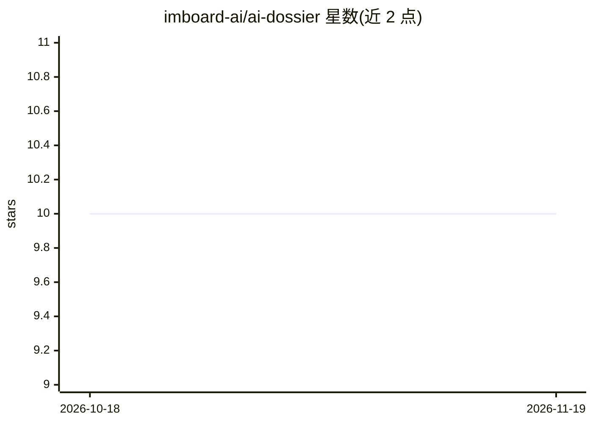

# imboard-ai/ai-dossier

⭐ 10 · TypeScript · AGPL-3.0 · 推送 2026-11-17 · [GitHub](https://github.com/imboard-ai/ai-dossier) · [官网](https://ai-dossier.dev) · 组织维护

**给 agent 技能加签名与版本的开源标准及 CLI 工具**

Dossier 定义了一种带 Ed25519 签名与语义版本的 agent 技能格式（.ds.md 文件），并配套 CLI、注册表与 MCP 服务器。模型按技能内容决定步骤，外层由不调用 LLM 的确定性调度器包裹。技能可托管在 GitHub、自建服务器或官方注册表，安装前可通过校验和与签名验证来源与完整性。明确说明签名不防止 prompt 注入。以 npm 包分发，另提供 Claude Code 插件与手动 MCP 配置接入方式。

## 筛选速览

| 维度 | 判定 | 备注 |
|---|---|---|
| AI 角色 | `ai-ecosystem` | LLM/agent 周边工具 |
| 许可风险 | `viral` | AGPL-3.0 |
| 部署形态 | `library` | 以包/库形式分发 |
| 模型依赖 | locked-api |  |
| 硬件要求 | — | 无带数字的原话,不猜 |
| 安装摩擦 | `low` | 无编译、无系统依赖或容器化 |
| 成熟度 | — | 结构信号不足 |

## 能力要点

- 技能文件内置校验和与 Ed25519 签名，运行前可验证
- 确定性调度器 @ai-dossier/sched 不调用 LLM
- 多注册表支持：公共/内部/镜像并行查询与隔离凭证
- 兼容 Agent Skills/SKILL.md 格式，可互相导入导出

## 适用场景

- 团队间分发需要版本固定与来源验证的 agent 技能
- 为 Claude Code 添加技能的发现、验证与执行能力
- 在 CI 中运行带签名校验的自动化工作流

## 场景标签

 · 领域:AI 开发基础设施/agent 工具链

## 证据(README 行号)

> L1: # Dossier — Signed, Versioned Agent Skills for Model-Driven Orchestration
> L39: **What**: Skills (`.ds.md` files) any AI agent can run — signed, versioned, portable across tools
> L51: In *model-driven orchestration* the model decides the steps, the tool calls, the retries and when the work is done.

## 星数曲线

2026-10-18 10 → 2026-11-19 10（+0）

---
*卡片 v1 · prompt 1.4 · 生成 2026-11-19 · 置信度 high · 依据 README sha `67450c36fdfc` · [字段定义](../../DATASET.md)*
