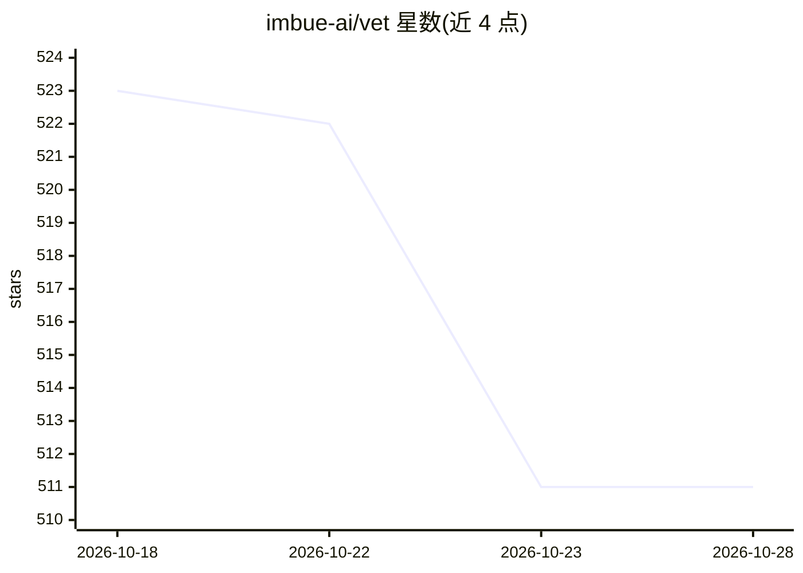

# imbue-ai/vet

⭐ 512 · Python · AGPL-3.0 · 推送 2026-09-14 · [GitHub](https://github.com/imbue-ai/vet) · 组织维护

**校验代码变更与 agent 行为的 LLM 审查工具**

面向使用编码代理的开发者的独立校验工具：对仓库快照与 diff 运行 LLM 检查，核验代码正确性以及 agent 对话与用户目标的一致性，输出过滤去重后的问题清单与退出码。可从终端、agent skill 或 CI（GitHub Action）运行，支持自带 API key 的任意 provider，也可通过 --agentic 复用 Claude Code/Codex/OpenCode 订阅。模型经 OpenAI 兼容端点自定义，内置 Anthropic/OpenAI/Gemini，另有社区模型注册表与 TOML 配置 profile。AGPL-3.0 许可。

## 筛选速览

| 维度 | 判定 | 备注 |
|---|---|---|
| AI 角色 | `ai-ecosystem` | LLM/agent 周边工具 |
| 许可风险 | `viral` | AGPL-3.0 |
| 部署形态 | `library` | 以包/库形式分发 |
| 模型依赖 | locked-api |  |
| 硬件要求 | — | 无带数字的原话,不猜 |
| 安装摩擦 | `low` | 无编译、无系统依赖或容器化 |
| 成熟度 | — | 结构信号不足 |

## 能力要点

- 对 diff 运行 LLM 检查并核验 agent 对话与目标的一致性
- 可作为 agent skill（.claude/.codex/.opencode 等）在代码变更后自动运行
- GitHub Action 在 PR 上运行审查并回帖
- OpenAI 兼容端点自定义模型 + 远程模型注册表 + TOML profiles

## 适用场景

- 我在编码 agent 改完代码后自动审查新增问题
- CI 流水线里对 PR 做目标一致性与正确性检查
- 用自己的 API key 接入任意模型做代码审查

## 场景标签

`代码审查` · 领域:编码与开发

## 证据(README 行号)

> L10:  Vet is a standalone verification tool for code changes and coding agent behavior .
> L124: Vet snapshots the repo and diff, optionally adds a goal and agent conversation, runs LLM checks, then filters/dedu

## 星数曲线

2026-10-18 523 → 2026-10-28 511（-12）

---
*卡片 v1 · prompt 1.4 · 生成 2026-10-21 · 置信度 high · 依据 README sha `d65c506272cf` · [字段定义](../../DATASET.md)*
