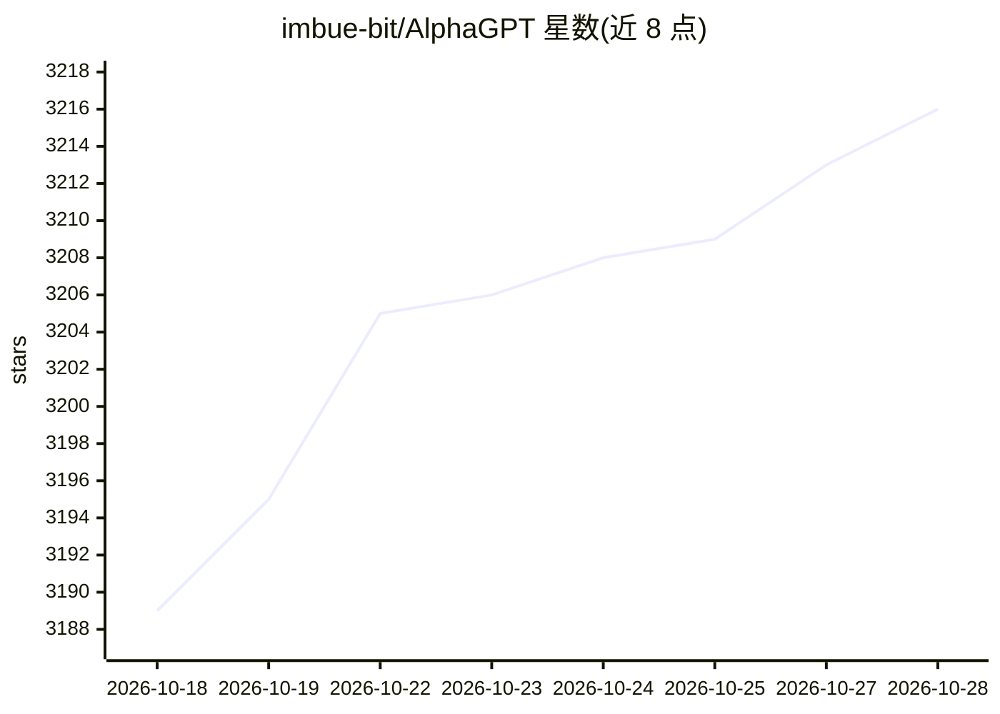

# imbue-bit/AlphaGPT

⭐ 3,216 · Python · Apache-2.0 · 推送 2026-06-12 · [GitHub](https://github.com/imbue-bit/AlphaGPT) · 组织维护 · 中文 README

**基于深度强化学习的自动因子工厂（量化金融）**

开源的量化金融项目，自述为基于深度强化学习的自动因子工厂，主题标签涉及 deep-learning、quantitative-finance、transformer、uniswap-v4 等。当前 README 仅保留简短说明：提及开源版本曾被社区用于管理 1.66 亿人民币规模资金、作者受到人身安全威胁及捐助渠道，未提供安装步骤、使用方法或 API 文档。README 可验证的功能与机制信息有限，选型前需自行查阅代码库。

## 筛选速览

| 维度 | 判定 | 备注 |
|---|---|---|
| AI 角色 | `ai-native` | 本体是模型或模型工具 |
| 许可风险 | `permissive` | Apache-2.0 |
| 部署形态 | `None` |  |
| 模型依赖 | — | README 未给出锁定关系 |
| 硬件要求 | — | 无带数字的原话,不猜 |
| 安装摩擦 | `low` | 无编译、无系统依赖或容器化 |
| 成熟度 | — | 结构信号不足 |

## 能力要点

- 自述为基于深度强化学习的自动因子工厂
- 主题标签涵盖 quant、transformer、uniswap-v4
- README 提及曾被社区用于管理 1.66 亿人民币规模资金

## 适用场景

- 量化研究中探索因子自动生成流程
- 研究深度强化学习在金融因子挖掘中的应用

## 场景标签

`金融量化` `强化学习` · 领域:学习与行业

## 证据(README 行号)

> L1: # AlphaGPT

## 星数曲线

2026-10-18 3,189 → 2026-10-28 3,216（+27）

---
*卡片 v1 · prompt 1.4 · 生成 2026-10-20 · 置信度 low · 依据 README sha `a77b0c2580c5` · [字段定义](../../DATASET.md)*
