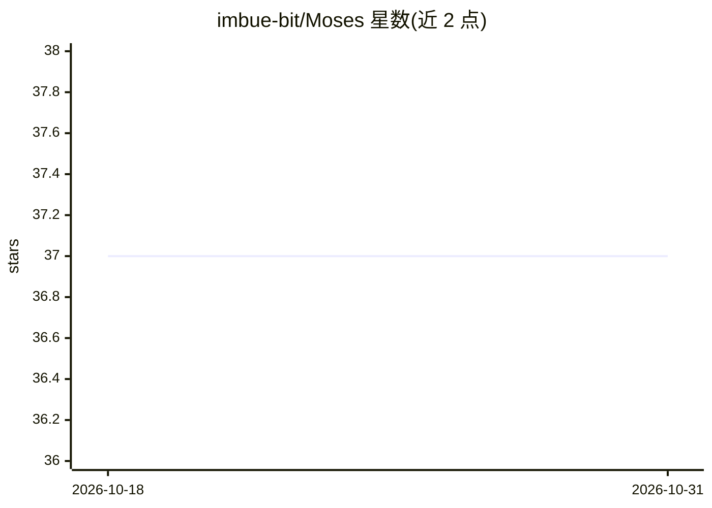

# imbue-bit/Moses

⭐ 37 · C++ · GPL-3.0 · 推送 2026-02-11 · [GitHub](https://github.com/imbue-bit/Moses) · 组织维护 · 中文 README

**全资产量化交易的信号聚合 ensemble 框架**

基于在线学习的量化交易信号聚合框架：将多模态因子（量价、基本面、GAF 视觉因子）映射至标准度量空间，以 Multiplicative Weights Update 遗憾界约束动态优化权重，结合 PPO 仓位控制与硬性风控截断，覆盖股票、期货、期权等资产。核心引擎用 C++17 编写，通过 Boost.Asio 异步分发交易指令。使用流程为 Python 训练导出 ONNX 模型，CMake 编译 C++ 内核后启动服务。依赖 Eigen3、Boost.Asio、ONNX Runtime、nlohmann-json。

## 筛选速览

| 维度 | 判定 | 备注 |
|---|---|---|
| AI 角色 | `ai-native` | 本体是模型或模型工具 |
| 许可风险 | `viral` | GPL-3.0 |
| 部署形态 | `None` |  |
| 模型依赖 | — | README 未给出锁定关系 |
| 硬件要求 | — | 无带数字的原话,不猜 |
| 安装摩擦 | `medium` | 含编译或系统依赖之一 |
| 成熟度 | — | 结构信号不足 |

## 能力要点

- MWU 在线学习理论驱动的多因子加权聚合
- 多模态融合：量价因子、基本面分数与 GAF 视觉因子
- C++17 内核 + Boost.Asio 异步交易指令分发
- PPO 动态仓位控制与预期缺口风控截断

## 适用场景

- 将多个 alpha 因子聚合为单一交易决策信号
- 跨资产类别（股票、期货、期权）做自适应策略集成
- 在实盘或研究系统中跑在线学习的信号权重优化

## 场景标签

`金融量化` · 领域:学习与行业

## 证据(README 行号)

> L12: Moses 是一个基于在线学习算法的全资产量化交易信号聚合 ensemble 框架。本项目融合了 Multiplicative Weights Update 的在线学习理论、GAF 的计算机视觉特征提取，以及 PPO 的深度强化学
> L16: 1. 多模态融合: 支持传统量价因子、基本面分数与 GAF 视觉因子的无缝集成。

## 星数曲线

2026-10-18 37 → 2026-10-31 37（+0）

---
*卡片 v1 · prompt 1.4 · 生成 2026-10-25 · 置信度 high · 依据 README sha `312ba0d700c4` · [字段定义](../../DATASET.md)*
