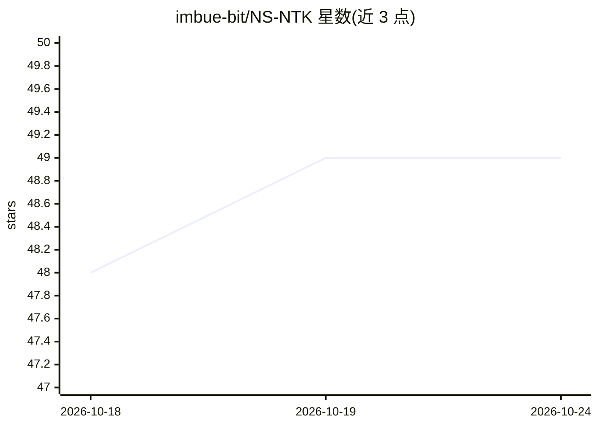

# imbue-bit/NS-NTK

⭐ 49 · Python · MIT · 推送 2026-05-27 · [GitHub](https://github.com/imbue-bit/NS-NTK) · 组织维护

**金融连续分布偏移论文官方代码：NS-NTK 理论实现**

论文《Deep Learning under Continuous Distribution Shift: The Non-Stationary NTK and Spectral Tracking SDE for Quantitative Finance》的官方实现仓库。README 说明代码包含 PVR 与 EAT 优化器、Exponential Aggregation 采样器和 Temporal Transformers。仓库定位为研究代码，面向阅读论文并复现实验的科研人员；README 本身未给出安装与运行说明。

## 筛选速览

| 维度 | 判定 | 备注 |
|---|---|---|
| AI 角色 | `ai-native` | 本体是模型或模型工具 |
| 许可风险 | `permissive` | MIT |
| 部署形态 | `None` |  |
| 模型依赖 | — | README 未给出锁定关系 |
| 硬件要求 | — | 无带数字的原话,不猜 |
| 安装摩擦 | `low` | 无编译、无系统依赖或容器化 |
| 成熟度 | — | 结构信号不足 |

## 能力要点

- 论文官方实现（Non-Stationary NTK 与 Spectral Tracking SDE）
- 包含 PVR 与 EAT 优化器
- 包含 Exponential Aggregation 采样器与 Temporal Transformers

## 适用场景

- 复现论文中的优化器与采样器实验
- 在量化金融连续分布偏移场景下做进一步研究

## 场景标签

`金融量化` `科研工具` · 领域:学习与行业

## 证据(README 行号)

> L1: # Deep Learning under Continuous Distribution Shift (NS-NTK)
> L5: Official implementation for the paper: **"Deep Learning under Continuous Distribution Shift: The Non-Stationary NTK 
> L7: Contains PVR and EAT optimizers, Exponential Aggregation samplers, and Temporal Transformers.

## 星数曲线

2026-10-18 48 → 2026-10-24 49（+1）

---
*卡片 v1 · prompt 1.4 · 生成 2026-10-24 · 置信度 mid · 依据 README sha `dce2ca302142` · [字段定义](../../DATASET.md)*
