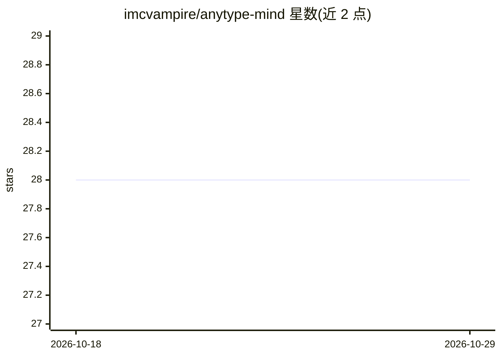

# imcvampire/anytype-mind

⭐ 28 · Shell · MIT · 推送 2026-04-07 · [GitHub](https://github.com/imcvampire/anytype-mind) · 个人维护

**给 AI 编码助手接入 Anytype 结构化记忆库的技能包**

基于 Anytype 的知识库模板与工具集：通过引导脚本在 Anytype 空间创建 12 种对象类型（工作笔记、事件、决策、人员、团队等）及其关系，再通过 Anytype MCP server 供 Claude Code、Codex、Cursor 等 AI 工具读写。含 5 个生命周期钩子（会话启动加载上下文、提示分类路由、工具调用后校验、备份等）、14 个 slash 命令与 8 个专用子代理，覆盖晨会、自由记录、绩效评审证据收集等流程。需本地运行 Anytype 桌面端、Python 3 与 Node.js。

## 筛选速览

| 维度 | 判定 | 备注 |
|---|---|---|
| AI 角色 | `ai-ecosystem` | LLM/agent 周边工具 |
| 许可风险 | `permissive` | MIT |
| 部署形态 | `library` | 以包/库形式分发 |
| 模型依赖 | — | README 未给出锁定关系 |
| 硬件要求 | — | 无带数字的原话,不猜 |
| 安装摩擦 | `low` | 无编译、无系统依赖或容器化 |
| 成熟度 | — | 结构信号不足 |

## 能力要点

- bootstrap 脚本在 Anytype 中创建 12 种对象类型与关系模式
- 5 个生命周期钩子自动加载上下文与分类路由
- 14 个 slash 命令与 8 个专用子代理
- 同时支持 Claude Code、Codex、Cursor 三种 AI 工具接入

## 适用场景

- 让 Claude Code 等 AI 助手跨会话记住我的工作上下文
- 把日常工作、事件、决策沉淀为结构化对象并建立关联
- 绩效季自动汇总证据生成 review brief 与自我评估

## 场景标签

`知识库管理` `Agent 记忆` · 领域:Agent 开发

## 证据(README 行号)

> L40: claude mcp add anytype -e OPENAPI_MCP_HEADERS='{"Authorization":"Bearer <KEY>", "Anytype-Version":"2025-11-08"}' -s
> L77: All data lives as **typed Anytype objects** with properties and relations. AI agents interact via the **Anytype MCP
> L87: |SessionStart|Loads North Star, active work, recent changes via Anytype MCP|

## 星数曲线

2026-10-18 28 → 2026-10-29 28（+0）

---
*卡片 v1 · prompt 1.4 · 生成 2026-10-26 · 置信度 mid · 依据 README sha `5148f5cd8000` · [字段定义](../../DATASET.md)*
