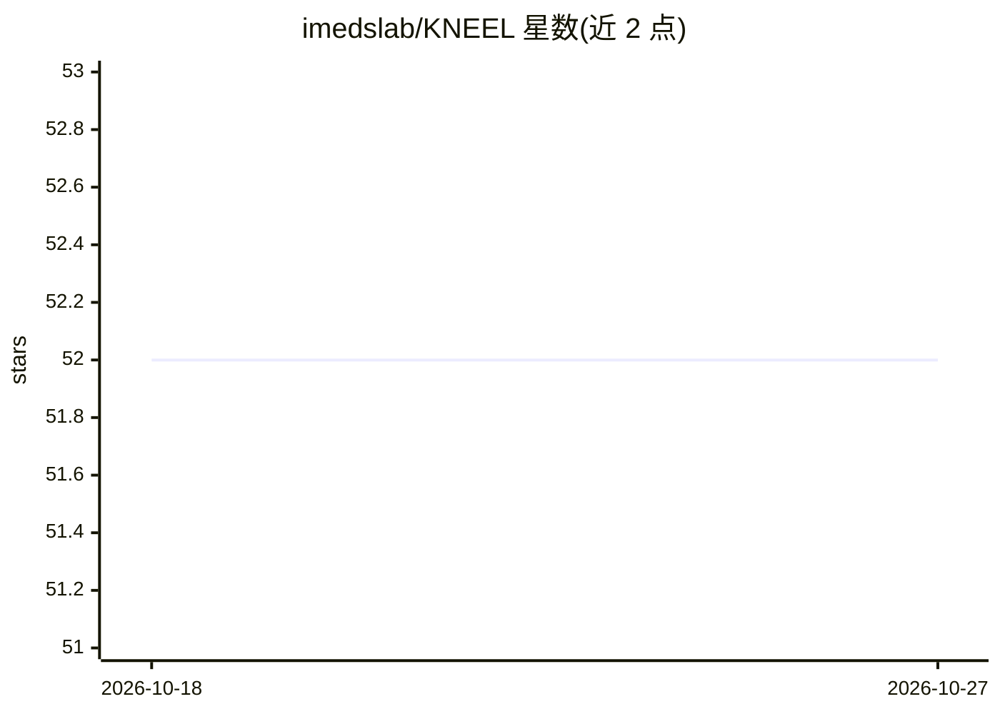

# imedslab/KNEEL

⭐ 52 · Python · 推送 2026-06-15 · [GitHub](https://github.com/imedslab/KNEEL) · 组织维护

**膝关节X光片解剖标志点定位模型推理包（论文KNEEL）**

KNEEL 论文的 PyTorch 推理实现：用 Hourglass 网络架构检测膝关节解剖标志点，在多个数据集上验证。仓库以 Docker 化 web 应用形式提供，需先获取 HuggingFace 仓库访问权限并生成 token；提供 CPU 与 GPU 镜像两种运行方式。预测通过 HTTP POST 发送 base64 编码的 DICOM 图像到 /kneel/predict/bilateral 端点，返回 16 个标志点的 (x, y) 坐标。面向医学影像分析相关研究者与开发者，论文发表于 ICCV 2019 VRMI Workshop。

## 筛选速览

| 维度 | 判定 | 备注 |
|---|---|---|
| AI 角色 | `ai-native` | 本体是模型或模型工具 |
| 许可风险 | `none` | — |
| 部署形态 | `self-host` | docker 或自建部署 |
| 模型依赖 | — | README 未给出锁定关系 |
| 硬件要求 | — | 无带数字的原话,不猜 |
| 安装摩擦 | `low` | 无编译、无系统依赖或容器化 |
| 成熟度 | — | 结构信号不足 |

## 能力要点

- Docker 化 web 应用，经 http 协议访问
- 输入 DICOM（base64），输出 16 个解剖标志点坐标
- 提供 CPU 与 GPU 两种镜像
- 模型权重托管在 HuggingFace，token 自动审批

## 适用场景

- 对膝关节 X 光片做双侧标志点定位
- 在膝骨关节炎分析流程中获取解剖标志点坐标
- 复现或引用 KNEEL 论文的推理结果

## 场景标签

`目标检测` · 领域:感知与多模态

## 证据(README 行号)

> L7: This repo contains an inference package for the models trained in our paper KNEEL. In that paper, we have developed 
> L45: To make predictions, just send a POST request with a json having `{"dicom":<RAW_DICOM_IN_BASE_64>}` to `/kneel/pred
> L53: response = requests.post("http://localhost:5000/kneel/predict/bilateral", json={'dicom': data_base64})

## 星数曲线

2026-10-18 52 → 2026-10-27 52（+0）

---
*卡片 v1 · prompt 1.4 · 生成 2026-10-24 · 置信度 high · 依据 README sha `46aabcd90b11` · [字段定义](../../DATASET.md)*
