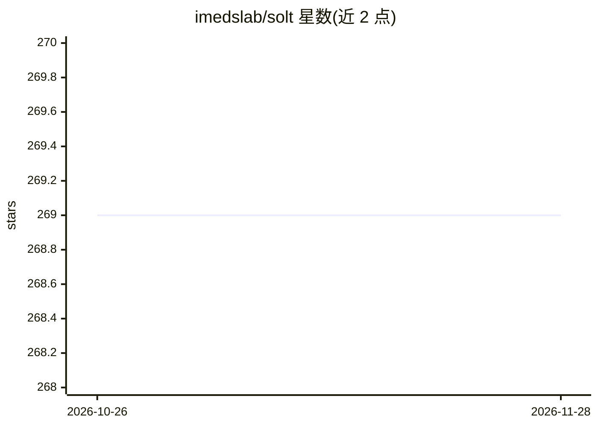

# imedslab/solt

⭐ 269 · Jupyter Notebook · MIT · 推送 2026-11-14 · [GitHub](https://github.com/imedslab/solt) · [官网](https://imedslab.github.io/solt/) · 组织维护

**深度学习数据增强库：流式变换图像/掩码/关键点/边界框**

SOLT 是一个面向深度学习的流式数据增强库，统一的变换流可同时处理图像、分割掩码、距离场、关键点、边界框与标签，支持单次对多种数据项同步变换。后端基于 OpenCV，输出可直接转为 PyTorch 张量，提供序列化 API 与可扩展的变换组件。作者为奥卢大学医学院研究人员，README 给出与 albumentations、torchvision、augmentor 在同一基准下的吞吐数据，并附引用 BibTeX。

## 筛选速览

| 维度 | 判定 | 备注 |
|---|---|---|
| AI 角色 | `ai-ecosystem` | LLM/agent 周边工具 |
| 许可风险 | `permissive` | MIT |
| 部署形态 | `library` | 以包/库形式分发 |
| 模型依赖 | — | README 未给出锁定关系 |
| 硬件要求 | — | 无带数字的原话,不猜 |
| 安装摩擦 | `medium` | 含编译或系统依赖之一 |
| 成熟度 | — | 结构信号不足 |

## 能力要点

- 一次变换同步处理图像/掩码/距离图/关键点/边界框/标签
- 后端使用 OpenCV，输出与 PyTorch 集成
- 提供 Stream 流式组合变换与序列化 API
- README 附与 albumentations/torchvision/augmentor 的基准数据

## 适用场景

- 为图像分类/分割/关键点检测任务生成训练增强数据
- 医学影像（MRI）配合掩码做多类别增强
- 在 PyTorch 训练管线中直接得到张量形式的增强结果

## 场景标签

 · 领域:深度学习/数据预处理

## 证据(README 行号)

> L9: A data augmentation library for Deep Learning that supports images, segmentation masks, distance maps
> L17: - Fast and PyTorch-integrated

## 星数曲线

2026-10-26 269 → 2026-11-28 269（+0）

---
*卡片 v1 · prompt 1.4 · 生成 2026-11-25 · 置信度 high · 依据 README sha `10f56c6e4457` · [字段定义](../../DATASET.md)*
