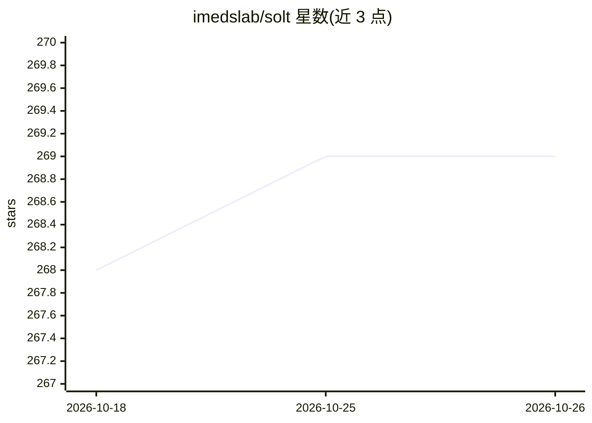

# imedslab/solt

⭐ 269 · Jupyter Notebook · MIT · 推送 2026-10-25 · [GitHub](https://github.com/imedslab/solt) · [官网](https://imedslab.github.io/solt/) · 组织维护

**面向深度学习的数据增强库，支持图像、掩码与关键点**

Python 数据增强库 SOLT：以流式（Stream）方式组合旋转、裁剪、翻转等变换，同时处理图像、分割掩码、标签与关键点（支持多对象一次变换），后端使用 OpenCV，提供 PyTorch 张量集成与序列化 API。面向计算机视觉/医学影像研究者的训练数据预处理，示例含脑部与膝关节 MRI 增强。pip 安装，README 含与 albumentations、torchvision、augmentor 的吞吐量基准。

## 筛选速览

| 维度 | 判定 | 备注 |
|---|---|---|
| AI 角色 | `ai-ecosystem` | LLM/agent 周边工具 |
| 许可风险 | `permissive` | MIT |
| 部署形态 | `library` | 以包/库形式分发 |
| 模型依赖 | — | README 未给出锁定关系 |
| 硬件要求 | — | 无带数字的原话,不猜 |
| 安装摩擦 | `medium` | 含编译或系统依赖之一 |
| 成熟度 | — | 结构信号不足 |

## 能力要点

- 图像/掩码/标签/关键点在同一变换流中联合增强
- OpenCV 后端与 PyTorch 张量集成
- 变换序列的序列化 API
- 提供与其他增强库的吞吐量基准数据

## 适用场景

- 训练分割模型前对影像与掩码做同步增强
- 关键点检测任务中图像与关键点联合变换
- 通过序列化 API 保存与复现增强配置

## 场景标签

 · 领域:计算机视觉/数据增强

## 证据(README 行号)

> L9: A data augmentation library for Deep Learning that supports images, segmentation masks, labels, and keypoints.
> L16: - Fast and PyTorch-integrated

## 星数曲线

2026-10-18 268 → 2026-10-26 269（+1）

---
*卡片 v1 · prompt 1.4 · 生成 2026-10-22 · 置信度 high · 依据 README sha `95b1a9797e9b` · [字段定义](../../DATASET.md)*
