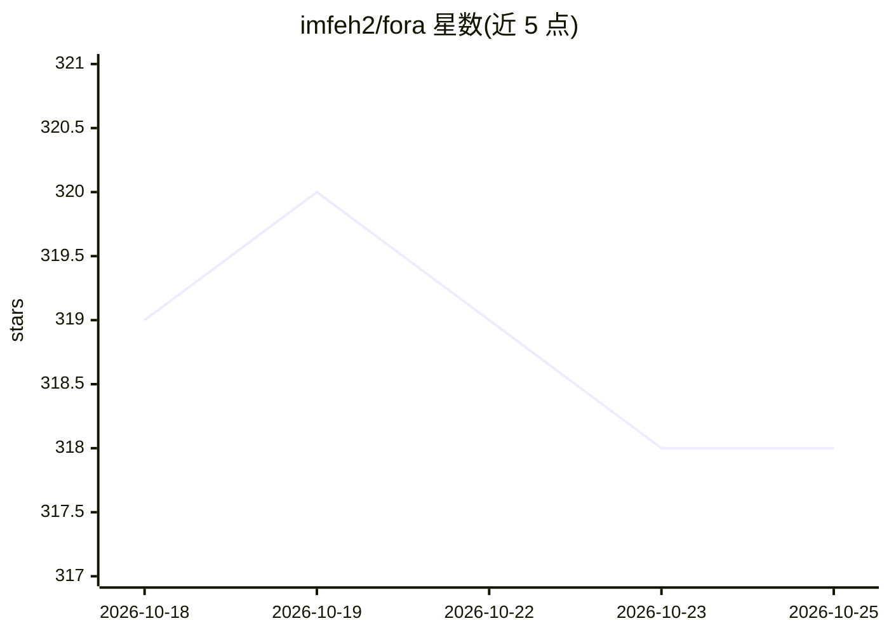

# imfeh2/fora

⭐ 318 · Python · Apache-2.0 · 推送 2026-10-25 · [GitHub](https://github.com/imfeh2/fora) · 个人维护

**自托管多 agent 组织的运行时（Web 访问配置）**

Fora 是一个自运行 agent 组织（organization of agents）的工具，提供 fora 与 fora-web 两个可执行入口，共享相同启动选项。README 可见部分仅记载域名访问配置：非回环监听器可直接接受域名，无需注册；回环监听器带 DNS rebinding 防护，可通过 --public-host 或 FORA_PUBLIC_HOSTS 环境变量声明公网域名，支持反向代理转发 HTTP 与 WebSocket，TLS 证书与代理安装需另行管理。产品的 agent 编排机制细节未在可见 README 中说明。

## 筛选速览

| 维度 | 判定 | 备注 |
|---|---|---|
| AI 角色 | `ai-ecosystem` | LLM/agent 周边工具 |
| 许可风险 | `permissive` | Apache-2.0 |
| 部署形态 | `None` |  |
| 模型依赖 | — | README 未给出锁定关系 |
| 硬件要求 | — | 无带数字的原话,不猜 |
| 安装摩擦 | `low` | 无编译、无系统依赖或容器化 |
| 成熟度 | — | 结构信号不足 |

## 能力要点

- 提供 fora / fora-web 双入口，共享同一套启动选项
- 非回环监听器可直接接受域名访问，无需注册
- 支持 --public-host 与 FORA_PUBLIC_HOSTS 声明多域名及子域
- 回环监听器内置 DNS rebinding 防护与拒绝说明页

## 适用场景

- 在自己服务器上运行 agent 组织并通过自有域名访问
- 在反向代理后以 HTTPS 暴露 fora-web 实例
- 为本机回环部署配置受控的公网域名白名单

## 场景标签

`多智能体` · 领域:Agent 开发

## 证据(README 行号)

> L3: Run your own organization of agents.
> L40: `fora` and `fora-web` use the same options. Loopback access and this computer's

## 星数曲线

2026-10-18 319 → 2026-10-25 318（-1）

---
*卡片 v1 · prompt 1.4 · 生成 2026-10-21 · 置信度 low · 依据 README sha `4142ae9f4dc8` · [字段定义](../../DATASET.md)*
