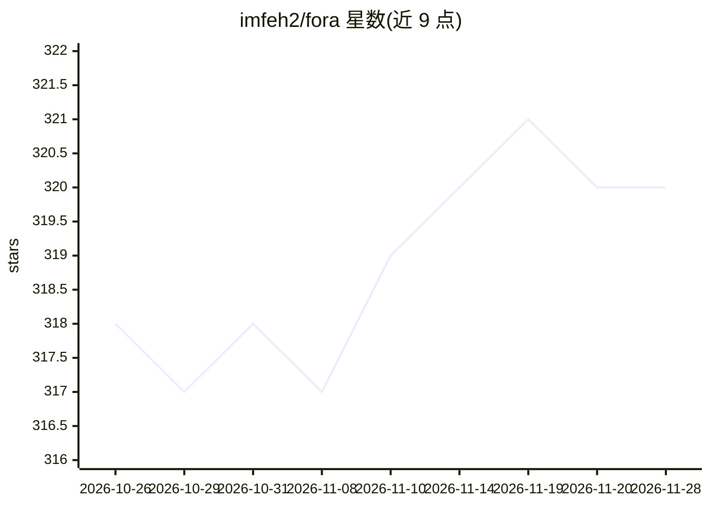

# imfeh2/fora

⭐ 320 · Python · Apache-2.0 · 推送 2026-11-21 · [GitHub](https://github.com/imfeh2/fora) · 个人维护

**运行自有 agent 组织的开源平台**

Fora 定位为运行一组 agent（"organization of agents"）的平台，README 仅给出该一句话描述，未说明具体功能机制、使用对象、安装方式或运行要求。从主题标签看涉及 agent 运行时、MCP、LLM、FastAPI、Rust 等技术栈，但 README 正文未展开任何细节。

## 筛选速览

| 维度 | 判定 | 备注 |
|---|---|---|
| AI 角色 | `ai-ecosystem` | LLM/agent 周边工具 |
| 许可风险 | `permissive` | Apache-2.0 |
| 部署形态 | `None` |  |
| 模型依赖 | — | README 未给出锁定关系 |
| 硬件要求 | — | 无带数字的原话,不猜 |
| 安装摩擦 | `low` | 无编译、无系统依赖或容器化 |
| 成熟度 | — | 结构信号不足 |

## 能力要点

- 定位为运行自有 agent 组织的平台
- 主题标签涉及 MCP、LLM、agent-runtime 等技术方向

## 适用场景

- 运行和管理多个 agent 协作的流程
- 搭建自有组织的 agent 工作区

## 场景标签

`多智能体` `Agent 框架` · 领域:Agent 开发

## 证据(README 行号)

> L3: Run your own organization of agents.

## 星数曲线

2026-10-26 318 → 2026-11-28 320（+2）

---
*卡片 v1 · prompt 1.4 · 生成 2026-11-25 · 置信度 low · 依据 README sha `6f22e26d7243` · [字段定义](../../DATASET.md)*
