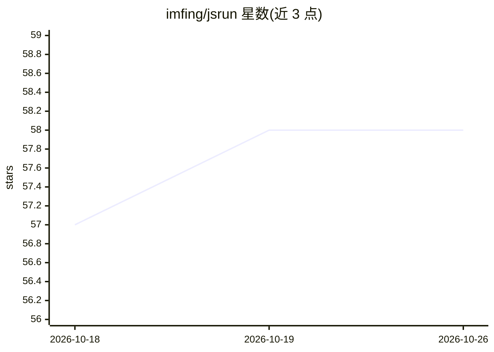

# imfing/jsrun

⭐ 58 · Rust · MIT · 推送 2026-10-07 · [GitHub](https://github.com/imfing/jsrun) · [官网](https://imfing.github.io/jsrun/) · 个人维护

**给 Python 开发者的嵌入式 V8 JavaScript 运行时库**

以 PyO3 用 Rust 封装 V8 引擎的 Python 库：在 Python 进程内执行可信或用户提供的 JavaScript，支持将 Python 函数/对象绑定进 JS 环境。安全机制包括运行时默认零 I/O、每线程独立 V8 isolate、可配置堆/时间限制。支持异步 API、ES 模块自定义加载器与直接执行 WebAssembly。定位之一是为 AI agent 提供执行 LLM 生成代码的沙箱（示例搭配 Pydantic AI）。需 Python 3.10+，仅支持 macOS/Linux；项目自述为实验性，版本间可能有破坏性变更。

## 筛选速览

| 维度 | 判定 | 备注 |
|---|---|---|
| AI 角色 | `ai-ecosystem` | LLM/agent 周边工具 |
| 许可风险 | `permissive` | MIT |
| 部署形态 | `library` | 以包/库形式分发 |
| 模型依赖 | — | README 未给出锁定关系 |
| 硬件要求 | — | 无带数字的原话,不猜 |
| 安装摩擦 | `low` | 无编译、无系统依赖或容器化 |
| 成熟度 | `idea` | |

## 能力要点

- V8 引擎经 Rust/PyO3 嵌入 Python，支持将 Python 对象绑定进 JS
- 默认零 I/O、每线程独立 isolate、可配置堆/时间限制
- 支持异步 JS 执行、ES 模块自定义 resolver 与 WASM
- 无需 Node.js 即可在 Python 中使用 JS 库（如从 CDN 加载 lodash/marked.js）

## 适用场景

- 为 AI agent 安全执行 LLM 生成的 JavaScript 代码（含堆限制与超时）
- 让用户上传 JS 自动化脚本由 Python 宿主运行
- 在 Python 数据工作流/笔记本中混用 JS 可视化库
- 按请求创建隔离 V8 isolate 的插件/Serverless 运行时

## 场景标签

 · 领域:开发工具/代码执行沙箱

## 证据(README 行号)

> L23: `jsrun` is a Python library that embeds the [V8][v8] JavaScript engine with Rust ([PyO3][pyo3]). Run trusted or use
> L74: - **AI agents** – execute LLM-generated JavaScript in isolated sandboxes with memory/time limits
> L82: One of the most compelling use cases for `jsrun` is building safe execution environments for AI agents. When LLMs g

## 星数曲线

2026-10-18 57 → 2026-10-26 58（+1）

---
*卡片 v1 · prompt 1.4 · 生成 2026-10-24 · 置信度 high · 依据 README sha `58842d01e462` · [字段定义](../../DATASET.md)*
