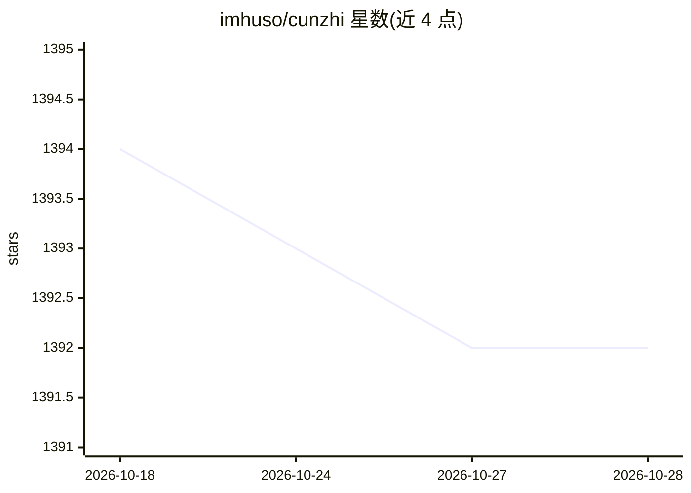

# imhuso/cunzhi

⭐ 1,392 · Rust · MIT · 推送 2026-05-12 · [GitHub](https://github.com/imhuso/cunzhi) · 个人维护 · 中文 README

**拦截 AI 提前结束对话的 MCP 工具，含记忆管理**

面向 MCP 客户端（如 Claude Desktop）的 MCP 服务器：当 AI 助手想结束对话时弹出对话框，提供预定义继续选项让用户选择；另提供按项目存储开发规范与偏好的记忆管理、设置界面（主题切换、提示词生成）以及基于 ACE 的语义代码搜索 MCP 工具。安装提供 macOS 的 brew 渠道与各平台二进制下载，Windows/Linux 推荐手动下载；本地开发用 pnpm + Tauri。核心代码搜索逻辑源自 acemcp 项目并用 Rust 重写。

## 筛选速览

| 维度 | 判定 | 备注 |
|---|---|---|
| AI 角色 | `ai-ecosystem` | LLM/agent 周边工具 |
| 许可风险 | `permissive` | MIT |
| 部署形态 | `library` | 以包/库形式分发 |
| 模型依赖 | — | README 未给出锁定关系 |
| 硬件要求 | — | 无带数字的原话,不猜 |
| 安装摩擦 | `low` | 无编译、无系统依赖或容器化 |
| 成熟度 | — | 结构信号不足 |

## 能力要点

- AI 想结束对话时自动弹出继续选项弹窗
- 按项目存储开发规范和偏好的记忆管理
- 设置界面支持提示词自动生成与主题切换
- 集成基于 ACE 的语义代码搜索 MCP 工具

## 适用场景

- 让 AI 助手在任务未完成时不提前终止对话
- 按项目保存开发规范供 AI 助手读取
- 为 AI 助手增加项目代码语义搜索能力

## 场景标签

`语义搜索` `Agent 记忆` · 领域:Agent 开发

## 证据(README 行号)

> L74: 在你的 MCP 客户端（如 Claude Desktop）配置文件中添加：
> L105: 寸止提供了多个 MCP 工具来增强 AI 助手的能力：

## 星数曲线

2026-10-18 1,394 → 2026-10-28 1,392（-2）

---
*卡片 v1 · prompt 1.4 · 生成 2026-10-21 · 置信度 mid · 依据 README sha `68bfdb402ba7` · [字段定义](../../DATASET.md)*
