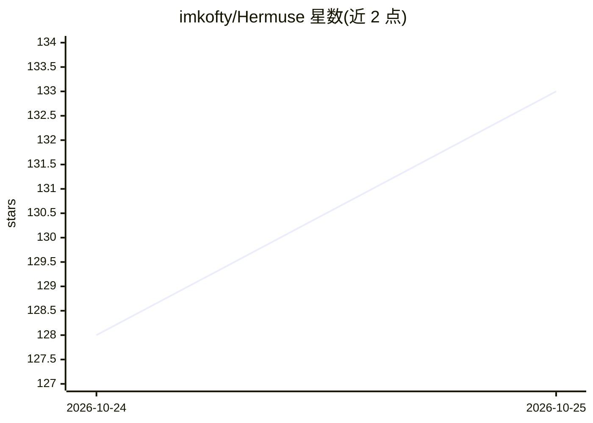

# imkofty/Hermuse

⭐ 137 · Shell · MIT · 推送 2026-10-23 · [GitHub](https://github.com/imkofty/Hermuse) · 个人维护

**自托管部署 Hermes agent + Telegram AI 机器人的运维脚本栈**

围绕 Nous Research 的 Hermes Agent 的自托管部署脚本集：install.sh 安装依赖、Node.js、Hermes 与 9Router；Telegram 网关以默认拒绝加数字 ID 白名单接入个人机器人；Cloudflare Pages 长轮询隧道（另有 cloudflared 替代脚本）暴露本地仪表盘，长轮询将空闲请求量降至约 4,300/天；watchdog 脚本配 cron/systemd 实现崩溃自动重启与开机自启。面向在自有 Linux VPS 上 24/7 运行个人 Telegram AI 机器人的用户；仓库本身为 Bash/Node 运维脚本，AI 能力来自所部署的 Hermes Agent。

## 筛选速览

| 维度 | 判定 | 备注 |
|---|---|---|
| AI 角色 | `ai-ecosystem` | LLM/agent 周边工具 |
| 许可风险 | `permissive` | MIT |
| 部署形态 | `None` |  |
| 模型依赖 | — | README 未给出锁定关系 |
| 硬件要求 | — | 无带数字的原话,不猜 |
| 安装摩擦 | `low` | 无编译、无系统依赖或容器化 |
| 成熟度 | — | 结构信号不足 |

## 能力要点

- 一键安装脚本：依赖、Node.js LTS、Hermes、9Router
- 三层防卡死网关看门狗：PID 检查、事件循环心跳、适配器活动检测
- Cloudflare Pages 长轮询隧道，空闲请求量约 4,300/天
- Telegram 网关默认拒绝 + 数字 ID 白名单，隧道鉴权 fail-closed

## 适用场景

- 在自己的 VPS 上 24/7 运行一个 Telegram AI 机器人
- 通过浏览器远程访问 9Router 模型仪表盘
- 让看门狗自动重启挂掉的服务，减少人工运维

## 场景标签

`AI 助手` `聊天机器人` · 领域:对话与助手

## 证据(README 行号)

> L19: **Hermuse = Hermes + Muse.** Scripts and guides to run Hermes Agent (the AI
> L20: agent from Nous Research) + 9Router + a Telegram gateway on your own server —
> L36: 1. `bash scripts/install.sh` — installs everything (dependencies, Hermes, 9Router)

## 星数曲线

2026-10-24 128 → 2026-10-25 133（+5）

---
*卡片 v1 · prompt 1.4 · 生成 2026-10-23 · 置信度 high · 依据 README sha `93c0b3b67980` · [字段定义](../../DATASET.md)*
