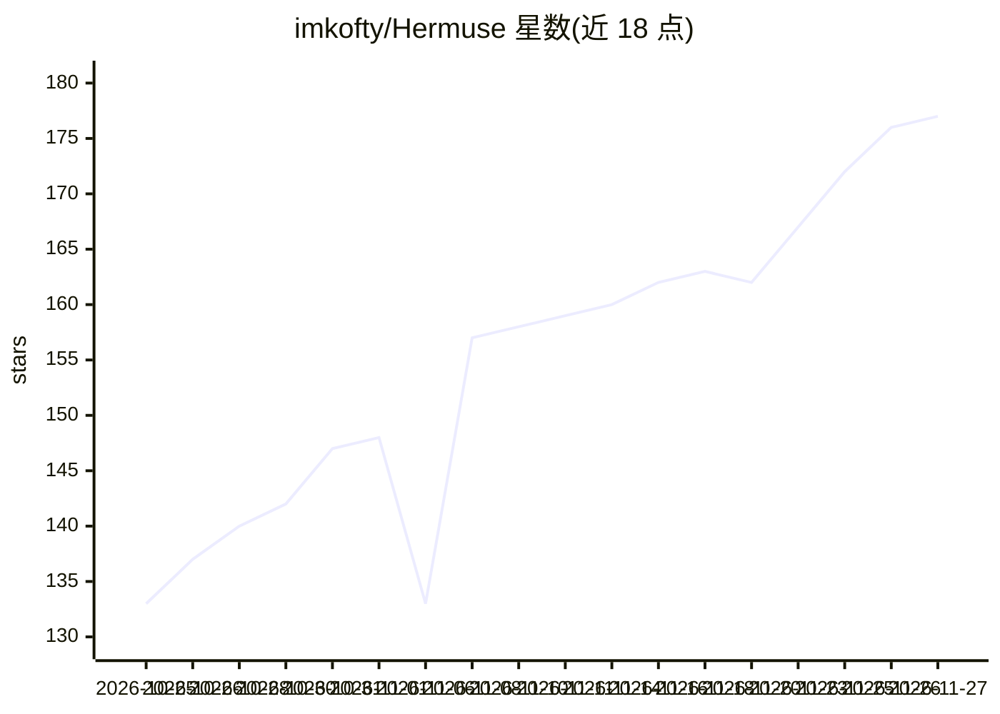

# imkofty/Hermuse

⭐ 177 · Shell · MIT · 推送 2026-11-22 · [GitHub](https://github.com/imkofty/Hermuse) · 个人维护 · 中文 README

**自托管个人 AI agent 部署脚本栈：一键装 Hermes+9Router+Telegram 网关**

面向自托管用户的部署与运维脚本集：在自有服务器/VPS 上安装 Nous Research 的 Hermes Agent、9Router 与 Telegram 网关，配套 Cloudflare 隧道暴露仪表盘、进程守护 watchdog、开机自启（cron @reboot/systemd）与三层防卡死网关检测。安全机制包括网关 ID 白名单、密钥文件 600 权限、隧道鉴权 fail-closed 与 D1 负载上限（1,350,000 字节）。需 Linux 环境与 passwordless sudo，MIT 许可。

## 筛选速览

| 维度 | 判定 | 备注 |
|---|---|---|
| AI 角色 | `ai-ecosystem` | LLM/agent 周边工具 |
| 许可风险 | `permissive` | MIT |
| 部署形态 | `None` |  |
| 模型依赖 | — | README 未给出锁定关系 |
| 硬件要求 | — | 无带数字的原话,不猜 |
| 安装摩擦 | `low` | 无编译、无系统依赖或容器化 |
| 成熟度 | — | 结构信号不足 |

## 能力要点

- install.sh 一键安装依赖、Node.js LTS、Hermes 与 9Router
- watchdog.sh + gateway-watch.sh 双层守护：进程存活性与事件循环心跳检测
- Cloudflare Pages 长轮询隧道替代 WebSocket/QUIC（空闲约 4,300 请求/天）
- Telegram 网关默认拒绝，仅白名单 ID 可用

## 适用场景

- 在 VPS 上 24/7 运行个人 Telegram AI 助手
- 浏览器访问自托管模型仪表盘
- 需开机自启与自动重启的 agent 服务运维

## 场景标签

`AI 助手` · 领域:对话与助手

## 证据(README 行号)

> L19: **Hermuse = Hermes + Muse.** Scripts and guides to run Hermes Agent (the AI
> L20: agent from Nous Research) + 9Router + a Telegram gateway on your own server —
> L84: |`scripts/install.sh`|From-scratch install: dependencies, Node.js LTS, Hermes, 9Router.|

## 星数曲线

2026-10-25 133 → 2026-11-27 177（+44）

---
*卡片 v1 · prompt 1.4 · 生成 2026-11-26 · 置信度 high · 依据 README sha `1752f71845e1` · [字段定义](../../DATASET.md)*
