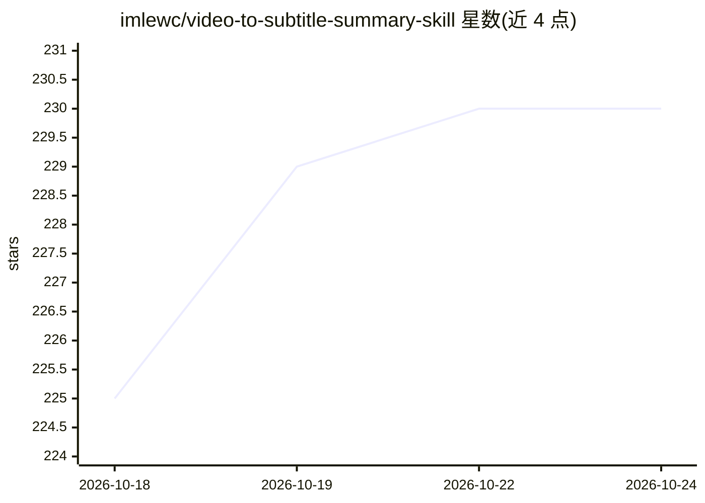

# imlewc/video-to-subtitle-summary-skill

⭐ 230 · Python · MIT · 推送 2026-07-19 · [GitHub](https://github.com/imlewc/video-to-subtitle-summary-skill) · [官网](https://top9.cc) · 个人维护 · 中文 README

**视频转字幕并生成 AI 摘要的 Codex/Claude Code Skill**

面向 Codex / Claude Code 的本地 Skill：输入抖音、小红书、B 站、YouTube 链接或本地视频/音频路径，自动下载（或直抓 YouTube 字幕）、提取音频、生成字幕并输出 AI 摘要。字幕后端可通过环境变量切换：默认本地 faster-whisper（无 API 费用，检测到 NVIDIA/CUDA 自动走 GPU），可选火山引擎 VC。视频解析默认用 AI Douyin 代理（解析扣积分），可换自有 TikHub Token。依赖 FFmpeg、yt-dlp，Python 3.9+；另提供在线免部署版本与私有化部署联系方式。

## 筛选速览

| 维度 | 判定 | 备注 |
|---|---|---|
| AI 角色 | `ai-native` | 本体是模型或模型工具 |
| 许可风险 | `permissive` | MIT |
| 部署形态 | `library` | 以包/库形式分发 |
| 模型依赖 | — | README 未给出锁定关系 |
| 硬件要求 | — | 无带数字的原话,不猜 |
| 安装摩擦 | `medium` | 含编译或系统依赖之一 |
| 成熟度 | — | 结构信号不足 |

## 能力要点

- 默认 faster-whisper 本地转写，无 API 费用，支持 CUDA 自动切换
- YouTube 链接优先用 yt-dlp 直抓字幕，无需 ASR
- 支持抖音/小红书/B 站/YouTube 在线视频与本地音视频文件
- 支持火山引擎 VC、TikHub 等可选后端切换

## 适用场景

- 在 Claude Code 里发链接直接获取短视频字幕和摘要
- 把本地录屏/音频文件转成带摘要的文字记录
- 批量抓取并总结 B 站/YouTube 视频内容

## 场景标签

`语音识别` `AI 写作` · 领域:内容生成

## 证据(README 行号)

> L3: 一个 Codex / Claude Code Skill，自动将短视频平台（抖音、小红书、B 站、YouTube 等）视频或本地视频/音频文件转换为字幕文本并生成 AI 摘要。
> L6: - **在线视频：** 提供视频链接 → 自动下载视频或直接抓字幕 → 生成字幕 → AI 总结
> L9: 默认字幕后端是本地 `faster-whisper`，也支持通过环境变量切换到火山引擎 VC。

## 星数曲线

2026-10-18 225 → 2026-10-24 230（+5）

---
*卡片 v1 · prompt 1.4 · 生成 2026-10-22 · 置信度 mid · 依据 README sha `fe2c9e9cd2a1` · [字段定义](../../DATASET.md)*
