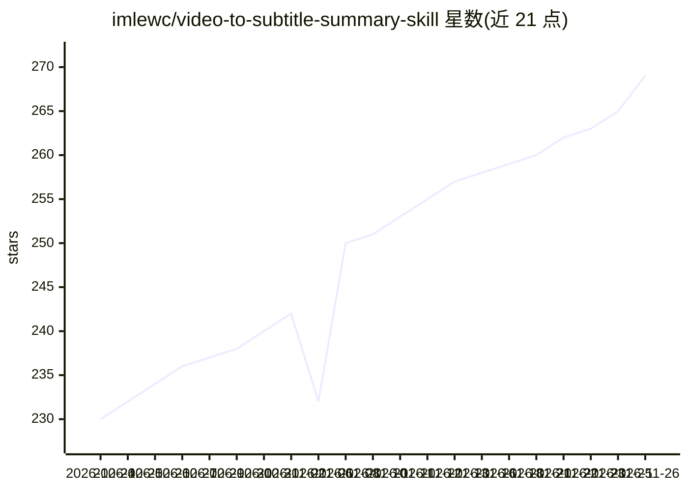

# imlewc/video-to-subtitle-summary-skill

⭐ 269 · Python · MIT · 推送 2026-11-15 · [GitHub](https://github.com/imlewc/video-to-subtitle-summary-skill) · [官网](https://top9.cc) · 个人维护 · 中文 README

**给 Codex/Claude Code Agent 用的视频转字幕+AI 摘要 Skill**

以 Skill 形式安装在 Codex/Claude Code 等本地 Agent 环境中的视频字幕与摘要工具：输入抖音、小红书、B 站、YouTube 链接或本地视频/音频路径，经下载/抓字幕、音频提取、字幕后端转写后生成字幕文件与 AI 中文摘要。默认后端为本地 faster-whisper，可通过环境变量切换火山引擎 VC；YouTube 优先用 yt-dlp 直抓人工/自动字幕。支持私有化部署。

## 筛选速览

| 维度 | 判定 | 备注 |
|---|---|---|
| AI 角色 | `ai-native` | 本体是模型或模型工具 |
| 许可风险 | `permissive` | MIT |
| 部署形态 | `library` | 以包/库形式分发 |
| 模型依赖 | — | README 未给出锁定关系 |
| 硬件要求 | — | 无带数字的原话,不猜 |
| 安装摩擦 | `medium` | 含编译或系统依赖之一 |
| 成熟度 | — | 结构信号不足 |

## 能力要点

- 默认 faster-whisper 本地转写，无 API 转写费用，检测到 NVIDIA/CUDA 自动切 GPU
- YouTube 经 yt-dlp 优先直抓字幕，无字幕时回退 ASR 转写
- 抖音/小红书/B 站经 AI Douyin 或 TikHub 解析下载直链
- 提供 AI Douyin 历史任务查询脚本与私有化部署支持

## 适用场景

- 把短视频链接发给 Claude Code，拿到字幕文件和中文摘要
- 批量整理本地录制的音视频为文字稿并提炼要点
- 内网环境下私有化部署做视频字幕转写

## 场景标签

`语音识别` · 领域:感知与多模态

## 证据(README 行号)

> L3: 一个 Codex / Claude Code Skill，自动将短视频平台（抖音、小红书、B 站、YouTube 等）视频或本地视频/音频文件转换为字幕文本并生成 AI 摘要。
> L9: 默认字幕后端是本地 `faster-whisper`，也支持通过环境变量切换到火山引擎 VC。
> L24: 当前版本支持两种字幕转写后端：

## 星数曲线

2026-10-24 230 → 2026-11-26 269（+39）

---
*卡片 v1 · prompt 1.4 · 生成 2026-11-25 · 置信度 high · 依据 README sha `cff2f1903070` · [字段定义](../../DATASET.md)*
