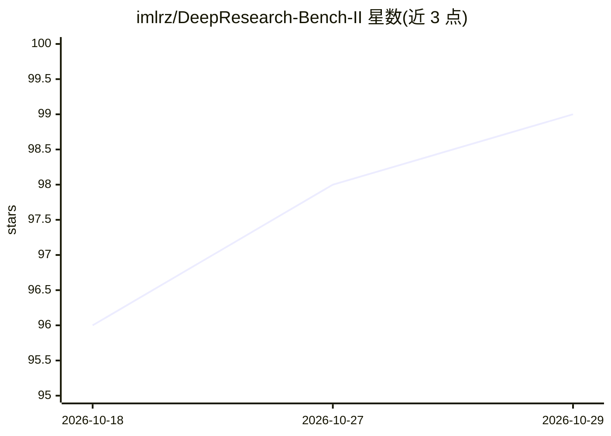

# imlrz/DeepResearch-Bench-II

⭐ 99 · Python · Apache-2.0 · 推送 2026-10-19 · [GitHub](https://github.com/imlrz/DeepResearch-Bench-II) · [官网](https://arxiv.org/abs/2601.08536) · 组织维护 · 中文 README

**深度研究 agent 评测基准：以专家报告分解的评分细则打分**

DeepResearch Bench II 是测量深度研究系统与人类专家差距的基准：从 132 篇专家撰写的研究报告出发，经 LLM 抽取、自评迭代、人工修订与专家审校四阶段构造 9,430 条二元可验证 rubrics，覆盖信息召回、分析、呈现三个维度。本仓库提供轻量评估管线：读取模型生成的 DOCX/Markdown 报告，调用 GPT-5.5 按批次对每条 rubric 输出 1/0/-1 评分与证据，聚合成 CSV；默认评估器已从 Gemini 2.5 Pro 迁移至 GPT-5.5，旧版保留在 gemini-25 分支。支持通过邮件提交模型并接入官方排行榜。

## 筛选速览

| 维度 | 判定 | 备注 |
|---|---|---|
| AI 角色 | `ai-ecosystem` | LLM/agent 周边工具 |
| 许可风险 | `permissive` | Apache-2.0 |
| 部署形态 | `None` |  |
| 模型依赖 | — | README 未给出锁定关系 |
| 硬件要求 | — | 无带数字的原话,不猜 |
| 安装摩擦 | `low` | 无编译、无系统依赖或容器化 |
| 成熟度 | — | 结构信号不足 |

## 能力要点

- 132 篇专家报告构造的 9,430 条三维度二元 rubrics
- LLM-as-judge 按批次评分，输出 score/reason/evidence 三元组
- 默认评估器为 GPT-5.5，支持 OpenAI 兼容端点
- 数据集发布于 Hugging Face，逐任务附带许可证元数据

## 适用场景

- 评估深度研究 agent 生成报告的质量并定位差距
- 将自研模型提交至官方排行榜对比
- 按信息召回/分析/呈现三维度做细粒度诊断

## 场景标签

`模型评测` · 领域:评测与运维

## 证据(README 行号)

> L68: This repository (`DeepResearch-Bench-II`) contains a **lightweight evaluation pipeline** that:
> L72: - Invokes GPT-5.5 to **score each rubric item** in batches, producing:
> L128: DeepResearch Bench II uses **LLM-as-judge with verifiable rubrics**:

## 星数曲线

2026-10-18 96 → 2026-10-29 99（+3）

---
*卡片 v1 · prompt 1.4 · 生成 2026-10-23 · 置信度 high · 依据 README sha `973377cdd5ed` · [字段定义](../../DATASET.md)*
