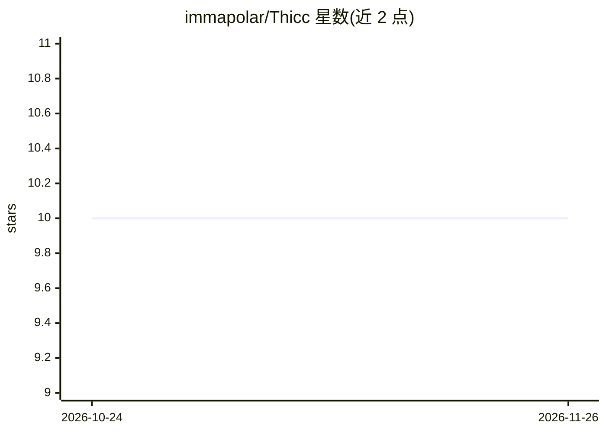

# immapolar/Thicc

⭐ 10 · JavaScript · 推送 2026-07-17 · [GitHub](https://github.com/immapolar/Thicc) · 个人维护

**压缩 Claude Code 对话 JSONL 的 CLI，消除上下文告警**

针对 Claude Code 会话文件的 Node.js CLI 工具：读取 `.jsonl` 对话记录，按规则删除旧的工具调用对或用 AI 对被删片段生成摘要后嵌入文件，输出 Claude Code 兼容的 JSONL。提供 Safe（无 AI、<5 秒）、Medium/Aggressive（经 Ollama 调用本地模型摘要）、Smart（按 1500 KB 阈值实时监控并增量压缩）四种模式，支持批量处理与工具对完整性校验；Ollama 不可用时回退 Safe 模式。面向 Claude Code 长会话用户，需 Node.js 16+。

## 筛选速览

| 维度 | 判定 | 备注 |
|---|---|---|
| AI 角色 | `ai-ecosystem` | LLM/agent 周边工具 |
| 许可风险 | `none` | — |
| 部署形态 | `library` | 以包/库形式分发 |
| 模型依赖 | local-ok | 支持本地模型 |
| 硬件要求 | — | 无带数字的原话,不猜 |
| 安装摩擦 | `low` | 无编译、无系统依赖或容器化 |
| 成熟度 | — | 结构信号不足 |

## 能力要点

- Safe 模式纯规则删除，无需 AI 调用；Medium/Aggressive 模式经 Ollama 生成摘要
- Smart 模式实时监控会话文件，按 1500 KB/+500 KB 阈值增量压缩
- 仅压缩旧上下文，保留最近消息，输出 Claude Code 兼容 JSONL
- 批量处理与 Ollama 不可用时自动回退 Safe 模式

## 适用场景

- 长会话中遇到 Context low 告警时压缩会话文件而不重启对话
- 开会前挂 Smart 模式自动监控并压缩会话文件
- 批量处理多个 Claude Code 会话记录以减小文件体积

## 场景标签

 · 领域:AI 开发者工具/上下文管理

## 证据(README 行号)

> L9: **JSONL Conversation Compressor for Claude Code**
> L45: **Thicc** compresses Claude Code `.jsonl` conversation files by intelligently clearing old context while keeping th
> L64: > - Ollama (optional, for Medium/Aggressive AI-powered modes)

## 星数曲线

2026-10-24 10 → 2026-11-26 10（+0）

---
*卡片 v1 · prompt 1.4 · 生成 2026-11-19 · 置信度 high · 依据 README sha `f5a3d31ba14f` · [字段定义](../../DATASET.md)*
