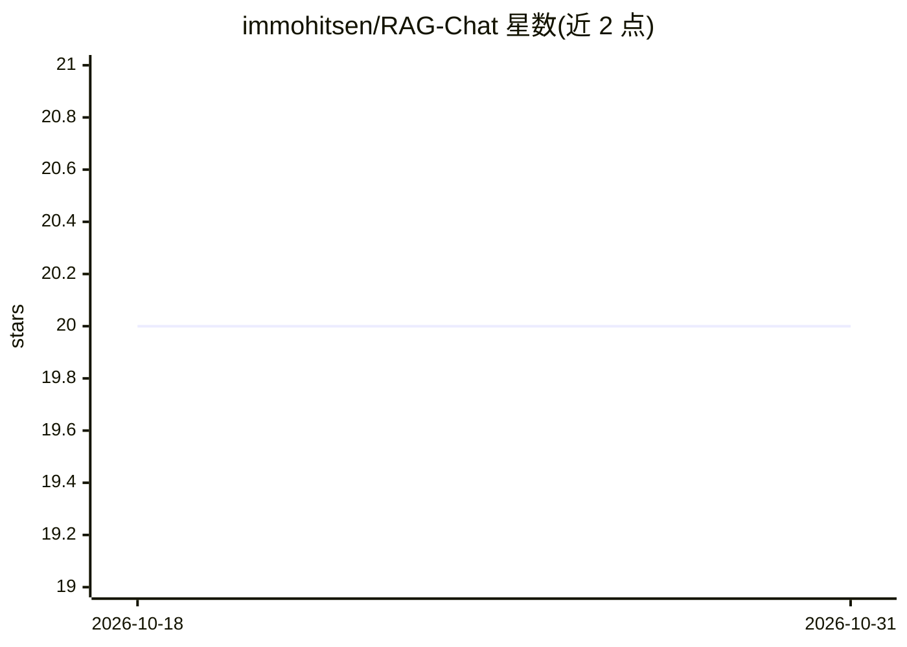

# immohitsen/RAG-Chat

⭐ 20 · JavaScript · 推送 2026-09-08 · [GitHub](https://github.com/immohitsen/RAG-Chat) · [官网](https://rag-chat-lac.vercel.app) · 个人维护

**面向终端用户的文档问答应用：上传文件、基于文档获得带引用的回答**

React + FastAPI 构建的 RAG 文档问答应用：用户注册登录后可上传 PDF、Word、Excel、TXT、CSV、JSON 等文件，问答时选择文件作为上下文，回答附带所引用文档片段与置信度分数。检索采用 MongoDB Atlas Vector Search 与 all-MiniLM-L6-v2 嵌入，LLM 为经 Groq 调用的 Llama 3.1；闲聊意图直接处理、文档查询走 RAG 管线。文件存储于 AWS S3，支持原文下载与对话历史续聊，可部署到 AWS Lambda 与 Vercel。

## 筛选速览

| 维度 | 判定 | 备注 |
|---|---|---|
| AI 角色 | `ai-native` | 本体是模型或模型工具 |
| 许可风险 | `none` | — |
| 部署形态 | `library` | 以包/库形式分发 |
| 模型依赖 | locked-api |  |
| 硬件要求 | — | 无带数字的原话,不猜 |
| 安装摩擦 | `low` | 无编译、无系统依赖或容器化 |
| 成熟度 | — | 结构信号不足 |

## 能力要点

- 多格式文档上传问答（PDF/Word/Excel/TXT/CSV/JSON）
- 回答附带引用的文档片段与置信度分数
- 用户数据隔离、对话历史保存、会话级摘要记忆
- 意图检测：闲聊直接处理，文档查询走 RAG 管线

## 适用场景

- 上传自己的文档并通过对话提问获取有出处的答案
- 按查询选择部分文件作为回答上下文
- 多用户环境下各自独立管理文档与对话历史

## 场景标签

`文档问答` · 领域:知识与检索

## 证据(README 行号)

> L3: A document-based AI assistant. Upload your files, ask questions, get answers grounded in your documents.
> L9: - **Document Q&A** — Upload PDFs, Word, Excel, TXT, CSV, JSON and chat with them
> L26: |LLM|Llama 3.1 via Groq|

## 星数曲线

2026-10-18 20 → 2026-10-31 20（+0）

---
*卡片 v1 · prompt 1.4 · 生成 2026-10-28 · 置信度 high · 依据 README sha `3bce6bb6e68d` · [字段定义](../../DATASET.md)*
