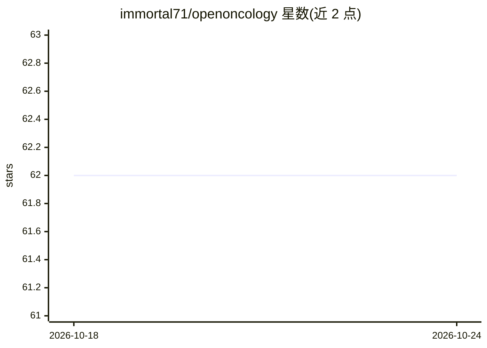

# immortal71/openoncology

⭐ 62 · Python · MIT · 推送 2026-10-23 · [GitHub](https://github.com/immortal71/openoncology) · 个人维护

**自托管精准肿瘤平台：从患者变异谱生成候选药物排序**

分析患者癌症突变谱，返回基于 FDA 批准证据（OncoKB 1-2 级、ClinVar、CIViC）的排序药物列表，覆盖批准疗法、老药新用与无匹配时的定制药物发现简报（基于 ChEMBL/OpenTargets 证据）。评分整合 AlphaMissense、DiffDock、OpenTargets 等多源，带耐药门控与四个输出面（证据/老药新用/发现/基准）。面向患者与肿瘤医生，自托管、核心功能无需 API key；声明未经 FDA/CE 审批，需肿瘤医生复核。提供 Docker 一键部署。

## 筛选速览

| 维度 | 判定 | 备注 |
|---|---|---|
| AI 角色 | `ai-native` | 本体是模型或模型工具 |
| 许可风险 | `permissive` | MIT |
| 部署形态 | `self-host` | docker 或自建部署 |
| 模型依赖 | — | README 未给出锁定关系 |
| 硬件要求 | — | 无带数字的原话,不猜 |
| 安装摩擦 | `low` | 无编译、无系统依赖或容器化 |
| 成熟度 | — | 结构信号不足 |

## 能力要点

- 变异谱→排序药物列表，多源证据评分（DiffDock/OpenTargets/OncoKB/AlphaMissense）
- 耐药门控（如 EGFR T790M 阻断 erlotinib）
- 四输出面：批准疗法/老药新用/发现简报/基准，含弃权机制
- 盲测 50 例肿瘤医生 holdout：Hit@3 0.900、零误报（论文冻结值）

## 适用场景

- 无法负担昂贵基因组咨询的患者获取循证药物排序参考
- 分子肿瘤板会诊前生成结构化证据摘要
- 复现论文基准或运行持续临床门控测试

## 场景标签

 · 领域:生物信息学/精准肿瘤

## 证据(README 行号)

> L23: OpenOncology is a free, open-source AI platform that analyses a patient's cancer mutation profile and returns a ran
> L27: > **All drug rankings are sourced from FDA-approved evidence (OncoKB Levels 1–2, ClinVar, CIViC) and ranked against
> L217: |**AI scoring**|AlphaMissense (3.6 GB SQLite) · AlphaFold Server · DiffDock · GPT-4o|

## 星数曲线

2026-10-18 62 → 2026-10-24 62（+0）

---
*卡片 v1 · prompt 1.4 · 生成 2026-10-24 · 置信度 high · 依据 README sha `de0c617368f2` · [字段定义](../../DATASET.md)*
