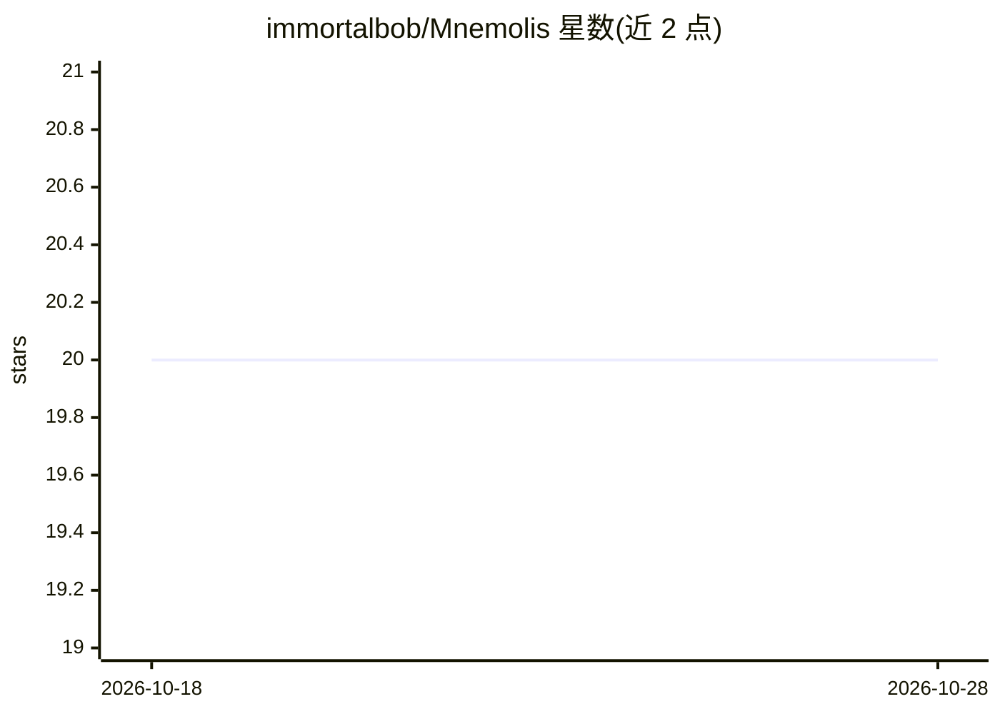

# immortalbob/Mnemolis

⭐ 20 · Python · MIT · 推送 2026-10-16 · [GitHub](https://github.com/immortalbob/Mnemolis) · 个人维护

**自托管家庭实验室的统一知识检索 API 与 MCP 服务**

以 Docker 容器运行于内网的检索路由层：单一端点接收自然语言查询，路由到 Kiwix 离线知识库、Open-Meteo 天气、FreshRSS、SearXNG、Uptime Kuma、Home Assistant 等后端，支持多源并发融合与意图自动识别；另含快照/历史引擎记录状态变化。可选 LLM 后端（默认 Ollama，兼容 OpenAI 格式）做智能路由与基于检索材料的答案合成。同时暴露 REST API 与 MCP server（Streamable HTTP），可接入 Open WebUI、Home Assistant、Claude Desktop 等客户端。除 Open-Meteo 外全部运行在自有基础设施上。

## 筛选速览

| 维度 | 判定 | 备注 |
|---|---|---|
| AI 角色 | `ai-ecosystem` | LLM/agent 周边工具 |
| 许可风险 | `permissive` | MIT |
| 部署形态 | `self-host` | docker 或自建部署 |
| 模型依赖 | local-ok | 支持本地模型 |
| 硬件要求 | — | 无带数字的原话,不猜 |
| 安装摩擦 | `low` | 无编译、无系统依赖或容器化 |
| 成熟度 | — | 结构信号不足 |

## 能力要点

- 单端点路由 8 类后端源，支持多源并发融合与意图自动检测
- 同时提供 REST API 与 MCP server，接入 Open WebUI/Home Assistant/Claude Desktop
- LLM 智能路由 + 基于检索材料的接地答案合成（可关闭）
- 快照与历史引擎记录家庭传感器/服务随时间的变化

## 适用场景

- 家庭实验室里用一个提问入口统一查离线百科、新闻、天气与设备状态
- 为 Open WebUI 或 MCP 客户端提供本地多源检索工具
- 让语音助手获得跨后端的简短有据回答

## 场景标签

`语义搜索` `RAG` · 领域:知识与检索

## 证据(README 行号)

> L7: A unified local knowledge search API for self-hosted homelabs. Mnemolis runs as a Docker container on your internal 
> L9: Exposes both a **REST API** and an **MCP server** so any client can connect to it.
> L36: |Open WebUI|REST|Lightweight tool that POSTs to `/search`|

## 星数曲线

2026-10-18 20 → 2026-10-28 20（+0）

---
*卡片 v1 · prompt 1.4 · 生成 2026-10-28 · 置信度 mid · 依据 README sha `c2b0c8a7ba38` · [字段定义](../../DATASET.md)*
