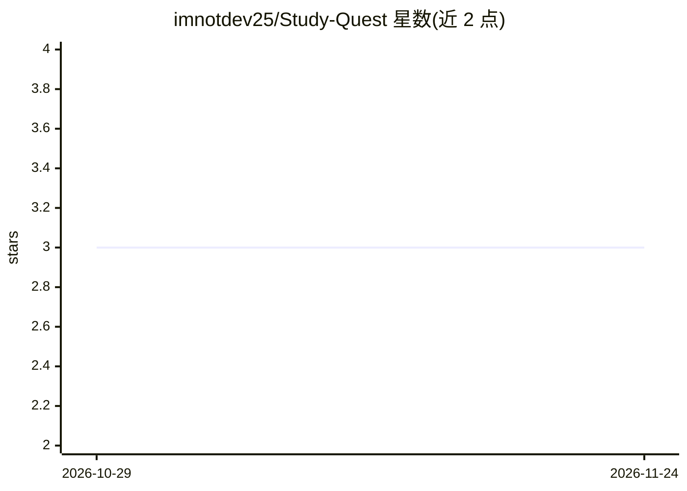

# imnotdev25/Study-Quest

⭐ 3 · HTML · 推送 2026-10-28 · [GitHub](https://github.com/imnotdev25/Study-Quest) · 个人维护

**把 RL/LLM/系统设计书籍变成可运行课程的学习桌面应用**

基于 Tauri 2 + React + Rust 的桌面应用，将五本书和两份动手指南整理为 RL、LLM、系统设计、AI Safety 四条学习路径。课程内嵌可运行 Python 单元、23 个交互式 marimo 笔记本、60 道带测试的编程练习、Excalidraw 绘图板和 3D 讲解视频，配套测验、复习与连击/XP 机制。全部数据保存在本地，Python 环境由 uv 一键创建或指向用户已有解释器。提供 macOS/Windows/Linux 安装包。

## 筛选速览

| 维度 | 判定 | 备注 |
|---|---|---|
| AI 角色 | `ai-enhanced` | 去掉 AI 部分产品仍成立 |
| 许可风险 | `none` | — |
| 部署形态 | `desktop` | 安装包/桌面程序 |
| 模型依赖 | — | README 未给出锁定关系 |
| 硬件要求 | — | 无带数字的原话,不猜 |
| 安装摩擦 | `medium` | 含编译或系统依赖之一 |
| 成熟度 | — | 结构信号不足 |

## 能力要点

- 课程内可运行的 Python 代码块与 23 个交互式 marimo 笔记本
- 60 道带测试的编程练习覆盖 DSA、RL、transformers、推理等
- 每个系统设计课程配 Excalidraw 绘图板，可导出 .excalidraw
- 全平台安装包，数据与计算全部留在本地

## 适用场景

- 按路径系统学习强化学习与 LLM 训练流程
- 在交互式笔记本里跑 PPO、注意力可视化等示例
- 通过 Excalidraw 练习系统设计作答
- 用测验、复习提示和连击机制维持学习习惯

## 场景标签

`教程课程` · 领域:学习与行业

## 证据(README 行号)

> L7: **Learn Reinforcement Learning, LLMs, System Design and AI Safety by doing, not just reading.**
> L9: Study Quest is a desktop app that turns five long-form books and two hands-on guides into lessons you can read, run,
> L11: Built with Tauri 2, React and Rust. Runs on macOS, Windows and Linux. Everything stays on your computer.

## 星数曲线

2026-10-29 3 → 2026-11-24 3（+0）

---
*卡片 v1 · prompt 1.4 · 生成 2026-11-21 · 置信度 mid · 依据 README sha `2e56ea0ef415` · [字段定义](../../DATASET.md)*
