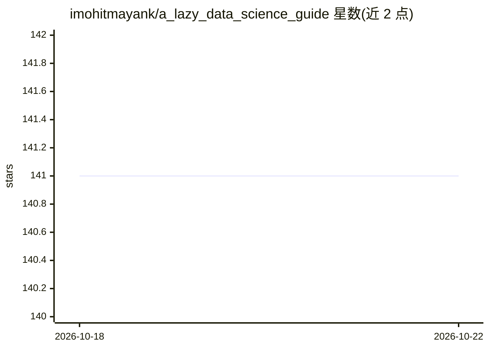

# imohitmayank/a_lazy_data_science_guide

⭐ 141 · 推送 2026-10-11 · [GitHub](https://github.com/imohitmayank/a_lazy_data_science_guide) · [官网](https://mohitmayank.com/a_lazy_data_science_guide/) · 个人维护

**面向数据科学家的知识整合指南书（代码片段与主题速查）**

由个人维护的数据科学指南书，以 MkDocs 部署为可检索的在线书籍。内容始于代码片段合集，计划逐步覆盖算法、应用、工具与最佳实践，目的是把散落在网络各处的相关主题整合到一处。无固定阅读顺序，读者可按主题搜索查阅。提供 Bibtex 引用格式，通过 GitHub issue 与讨论接受贡献，作者 Mohit Mayank 以个人身份维护。

## 筛选速览

| 维度 | 判定 | 备注 |
|---|---|---|
| AI 角色 | `ai-knowledge` | 知识聚合/清单类 |
| 许可风险 | `none` | — |
| 部署形态 | `None` |  |
| 模型依赖 | — | README 未给出锁定关系 |
| 硬件要求 | — | 无带数字的原话,不猜 |
| 安装摩擦 | `low` | 无编译、无系统依赖或容器化 |
| 成熟度 | — | 结构信号不足 |

## 能力要点

- 以书籍形式整合分散的数据科学主题
- MkDocs 构建的在线可搜索版本
- 提供 Bibtex 引用条目
- 通过 GitHub issue/讨论接受社区贡献

## 适用场景

- 按主题快速查找数据科学代码片段
- 系统浏览算法、工具与最佳实践资料
- 初学者或从业者作为速查手册使用

## 场景标签

`教程课程` · 领域:学习与行业

## 证据(README 行号)

> L9: **What is this?** A guide book on data science for busy and equally lazy Data Scientists 😄
> L11: **What does this include?** While the book started as a collection of snippets, the plan is to overtime include det

## 星数曲线

2026-10-18 141 → 2026-10-22 141（+0）

---
*卡片 v1 · prompt 1.4 · 生成 2026-10-22 · 置信度 high · 依据 README sha `f7fad8ee23f0` · [字段定义](../../DATASET.md)*
