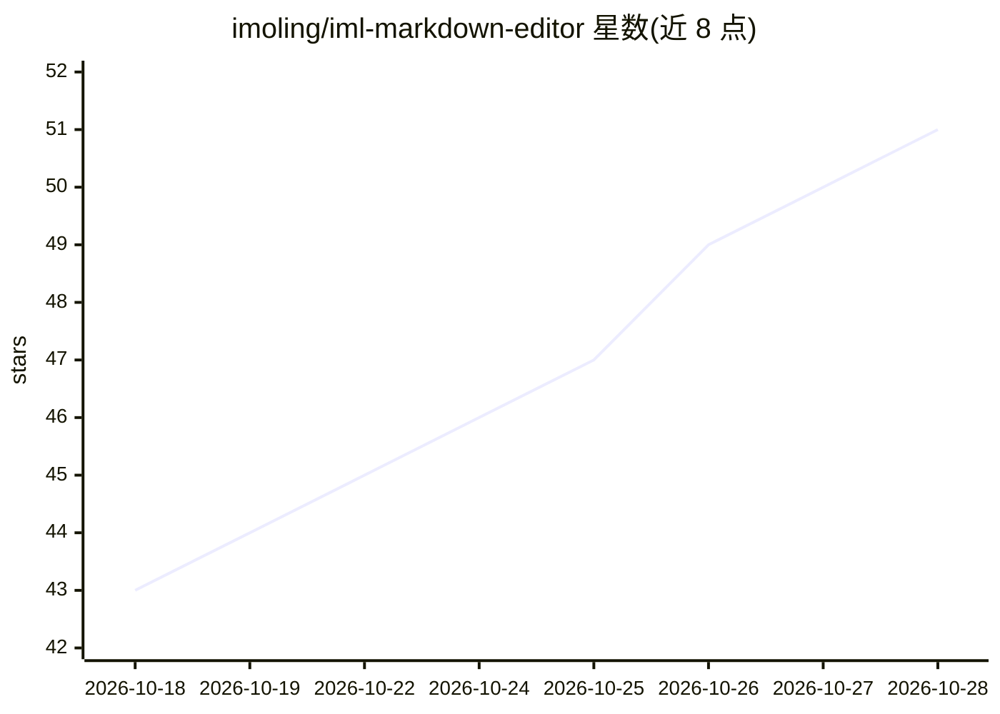

# imoling/iml-markdown-editor

⭐ 51 · TypeScript · NOASSERTION · 推送 2026-10-18 · [GitHub](https://github.com/imoling/iml-markdown-editor) · [官网](https://github.com/imoling/iml-markdown-editor/releases/latest) · 个人维护 · 中文 README

**本地优先的 Markdown 笔记编辑器：AI 写作/转写/生图全在本机跑**

面向长期写作与记笔记的本地 Markdown 编辑器（Electron，macOS/Windows 安装包 80~90 MB）。笔记即普通 .md 文件，放在用户自己的文件夹；兼容 Obsidian 的链接语法、属性、提示块并原样保存未编辑内容。AI 功能包括写作助手与自动续写、问笔记（向量召回+引用出处）、实时转写与说话人区分（sherpa-onnx/SenseVoice）、本机生图（stable-diffusion.cpp + GGUF）。本机模型经内置 llama.cpp 运行时下载运行，请求只发往 127.0.0.1，可一键关闭全部 AI；另有无 AI 的轻量版 iML 编辑器（Tauri，<4 MB）。

## 筛选速览

| 维度 | 判定 | 备注 |
|---|---|---|
| AI 角色 | `ai-enhanced` | 去掉 AI 部分产品仍成立 |
| 许可风险 | `none` | NOASSERTION |
| 部署形态 | `desktop` | 安装包/桌面程序 |
| 模型依赖 | local-ok | 支持本地模型 |
| 硬件要求 | — | 无带数字的原话,不猜 |
| 安装摩擦 | `low` | 无编译、无系统依赖或容器化 |
| 成熟度 | — | 结构信号不足 |

## 能力要点

- 写作助手/问笔记/实时转写/本机生图四项功能在本机完成，笔记与声音不上传
- 本机模型由编辑器托管（自动下载 llama.cpp 运行时与 GGUF 模型），按内存多模型调度
- Obsidian 笔记库可直接搬入：链接、嵌入、别名、frontmatter 原样往返
- AI 可一键全部关闭，状态栏显示请求发往本机还是云端

## 适用场景

- 长期记笔记并希望 AI 功能全程离线、数据不出本机
- 从 Obsidian 迁移笔记库继续用双向链接、日记与待办
- 会议/网课实时转写成笔记并区分说话人、回听定位
- 写作中用本机模型续写、润色并配 AI 生成的插图

## 场景标签

`AI 写作` `知识库管理` `语音识别` `图像生成` · 领域:内容生成

## 证据(README 行号)

> L14: 本地 Markdown 编辑器，为长期写作和记笔记设计。界面只保留必要的东西：左边一棵笔记库树，中间一页纸，其余交给快捷键、斜杠菜单和侧边栏。笔记就是普通的 `.md` 文件，放在你自己的文件夹里，随时可以用别的工具打开。
> L16: **写作助手、问你的笔记、实时转写、本机生图 —— 四件事全在这台电脑上完成**，模型用到才下载，笔记和声音都不出门。
> L129: - **AI 与隐私**：状态栏始终显示 AI 请求发往本机还是云端；设置里可一键关闭全部 AI，关闭后主进程也不再向任何模型服务发请求

## 星数曲线

2026-10-18 43 → 2026-10-28 51（+8）

---
*卡片 v1 · prompt 1.4 · 生成 2026-10-25 · 置信度 high · 依据 README sha `0f11b94cee69` · [字段定义](../../DATASET.md)*
