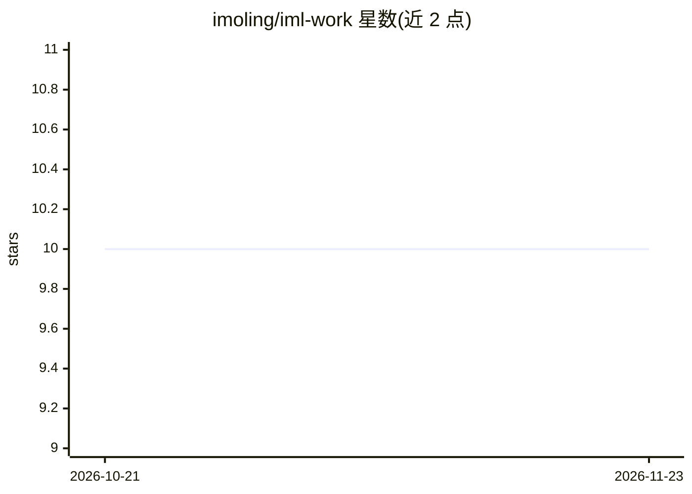

# imoling/iml-work

⭐ 10 · TypeScript · MIT · 推送 2026-10-18 · [GitHub](https://github.com/imoling/iml-work) · 组织维护 · 中文 README

**企业员工的 AI 分身：在 OA/CRM/ERP 里执行读写操作**

企业「工作分身」系统，分四个端：员工客户端（Electron）、管理后端与前端（Java 21/Spring Boot 3.3/PostgreSQL+pgvector）、FDE 工作台、演示用 Mock OA。核心机制：业务本体把用户话术消解成「对象+动作」；基于 browse-use/Playwright 录制存量系统操作形成可复用技能；写操作需确认卡签发一次性令牌；不可信代码进一次性 Docker 沙箱；AgentTrace 记录全链路审计。凭证与业务数据限定在员工本机。安装提供 Release 包、开发脚本与在线体验地址。

## 筛选速览

| 维度 | 判定 | 备注 |
|---|---|---|
| AI 角色 | `ai-native` | 本体是模型或模型工具 |
| 许可风险 | `permissive` | MIT |
| 部署形态 | `None` |  |
| 模型依赖 | local-ok | 支持本地模型 |
| 硬件要求 | — | 无带数字的原话,不猜 |
| 安装摩擦 | `medium` | 含编译或系统依赖之一 |
| 成熟度 | — | 结构信号不足 |

## 能力要点

- 本体语义层：对象/动作/状态机建模，四端共用
- browse-use 无侵入连接存量 OA/CRM/ERP，录制沉淀为语义脚本技能
- 写操作确认闸（一次性令牌）+ 代码沙箱（一次性容器断网执行）
- AgentTrace 全链路审计，导出带分级脱敏

## 适用场景

- 让分身代员工读 OA 待办、走审批流、写周报
- 给没有 API 的存量业务系统录制自动化操作技能
- 政企内网私有化部署，凭证与数据不出内网
- 企业知识库 RAG 问答与带引用的调研报告

## 场景标签

`浏览器自动化` `工作流自动化` `RAG` `AI 助手` · 领域:效率与自动化

## 证据(README 行号)

> L5:  企业「工作分身」系统 —— 员工电脑上跑一个能在真实 OA / CRM / ERP 里 真正动手 的 AI 分身。
> L169: 模型在一个 function-calling 循环里自主决策：联网检索、浏览网页和业务系统（带本人登录态）、查知识库、跑沙箱代码、调用业务技能，都是工具表里的选项。
> L227: 服务端 RAG 链路：docling 解析文档（表格、版面、OCR 扫描件）→ 切块 → bge-m3 算 1024 维向量 → pgvector 检索。相关性阈值按 bge-m3 实测标定过，换向量模型要改维度、重建全部向量（

## 星数曲线

2026-10-21 10 → 2026-11-23 10（+0）

---
*卡片 v1 · prompt 1.4 · 生成 2026-11-19 · 置信度 high · 依据 README sha `000e7385b746` · [字段定义](../../DATASET.md)*
