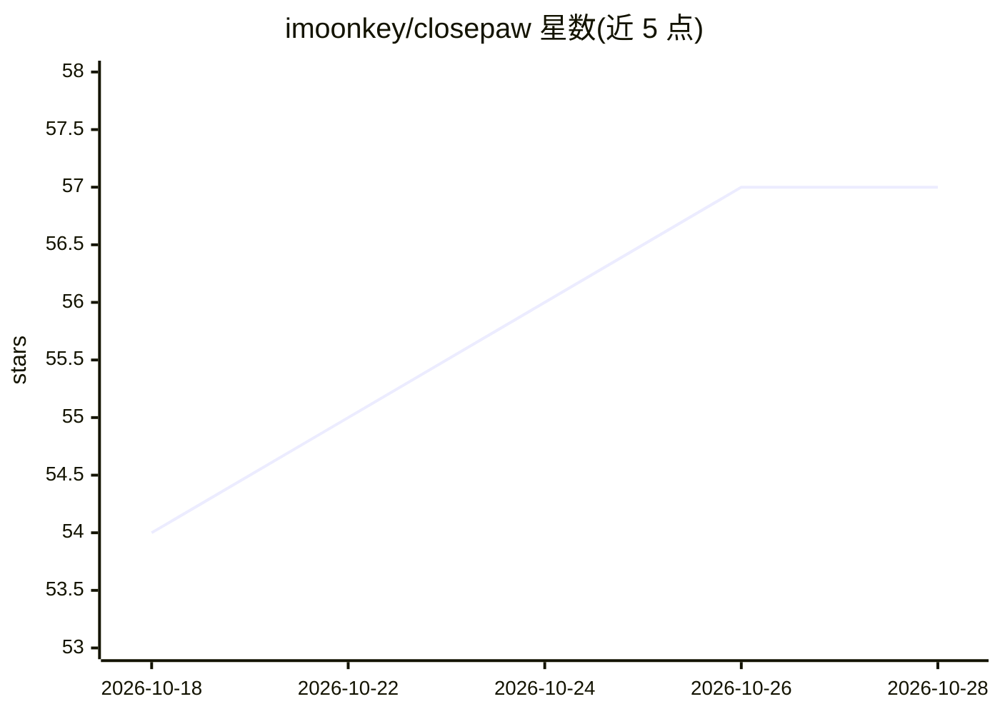

# imoonkey/closepaw

⭐ 57 · Kotlin · Apache-2.0 · 推送 2026-06-05 · [GitHub](https://github.com/imoonkey/closepaw) · 个人维护

**开源 Android 手机使用 agent：用自然语言让手机自动执行任务**

运行在 Android 手机本地的 phone-use agent：用户以文字或语音下达任务（如订餐位、总结 Slack 未读），agent 通过无障碍服务读取屏幕并执行点击/输入/滑动，也可经 Shizuku 在虚拟显示屏后台运行而不占用前台。内置 ReAct 循环、子任务委派、长期记忆与按应用加载的 app-skills；LLM 层可插拔，支持 OpenAI、OpenRouter、ChatGPT OAuth 登录及任意 OpenAI 兼容端点。银行/验证器类应用硬性屏蔽，FLAG_SECURE 页面不可见，无遥测。要求 Android 12+，提供签名 APK 或源码构建（需 JDK 17 与 Android SDK）。

## 筛选速览

| 维度 | 判定 | 备注 |
|---|---|---|
| AI 角色 | `ai-native` | 本体是模型或模型工具 |
| 许可风险 | `permissive` | Apache-2.0 |
| 部署形态 | `None` |  |
| 模型依赖 | locked-api |  |
| 硬件要求 | — | 无带数字的原话,不猜 |
| 安装摩擦 | `medium` | 含编译或系统依赖之一 |
| 成熟度 | `idea` | |

## 能力要点

- 通过无障碍服务在真实手机与真实账号上操作，无需 ADB 连电脑或云模拟器
- Shizuku 虚拟显示屏后台执行，前台可继续使用手机
- 可插拔 LLM 层：OpenAI / OpenRouter / ChatGPT OAuth / 任意 OpenAI 兼容端点
- 银行、验证器与加密钱包应用硬性屏蔽，FLAG_SECURE 屏幕对 agent 不可见

## 适用场景

- 用一句话让手机代替我完成多步操作（订位、比价、整理消息）
- 让 agent 后台处理任务，同时继续用手机聊天看视频
- 在已登录真实账号的应用里执行跨应用自动化

## 场景标签

`GUI 自动化` · 领域:效率与自动化

## 证据(README 行号)

> L13: ClosePaw is an open-source **agent harness for Android**. Give it a natural-language task ("book a table for two at
> L44: - 🧠 **A full on-device agent harness, in the making.** Built in Kotlin, native to Android. ReAct loop, no external 
> L56: - 🔌 **Pluggable LLM layer.** OpenAI-compatible API is the contract. ChatGPT/Codex OAuth flow built in. First-class:

## 星数曲线

2026-10-18 54 → 2026-10-28 57（+3）

---
*卡片 v1 · prompt 1.4 · 生成 2026-10-24 · 置信度 high · 依据 README sha `7f8fa05a683a` · [字段定义](../../DATASET.md)*
