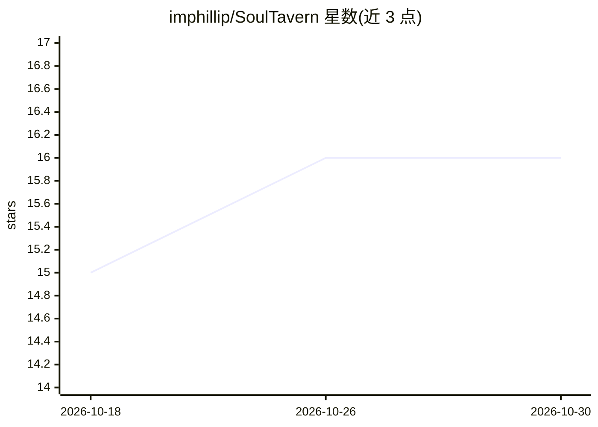

# imphillip/SoulTavern

⭐ 16 · Python · MIT · 推送 2026-05-11 · [GitHub](https://github.com/imphillip/SoulTavern) · [官网](https://soul.tavern.host/) · 个人维护 · 中文 README

**把 SillyTavern V2 角色卡转换为 SOUL.md 人格文件的 agent 技能**

单文件夹、纯标准库（Python ≥3.10）的 agent 技能：解析 SillyTavern V2 角色卡（.png/.json），做占位符替换与文本消毒（零宽字符/RTL 覆盖/控制符），渲染为 Hermes-Agent（SOUL.md+HERMES.md）或 OpenClaw（SOUL.md+AGENTS.md 托管段+IDENTITY.md）的系统提示文件；超预算卡片走 agent 驱动的八类拆分流程。内建五层安全机制（身份指令、信任横幅、作者字段降级、消毒、注入模式扫描）。限制：无关键词触发的世界书注入、无多角色同实例、无热编辑。

## 筛选速览

| 维度 | 判定 | 备注 |
|---|---|---|
| AI 角色 | `ai-ecosystem` | LLM/agent 周边工具 |
| 许可风险 | `permissive` | MIT |
| 部署形态 | `library` | 以包/库形式分发 |
| 模型依赖 | — | README 未给出锁定关系 |
| 硬件要求 | — | 无带数字的原话,不猜 |
| 安装摩擦 | `low` | 无编译、无系统依赖或容器化 |
| 成熟度 | — | 结构信号不足 |

## 能力要点

- V2 角色卡 → Hermes/OpenClaw 双目标的 SOUL.md 渲染
- 零第三方依赖，纯标准库，无需安装为包
- 五层安全默认：作者字段降级、消毒、提示注入扫描等
- 超预算卡片的 agent 驱动八类拆分流程

## 适用场景

- 把已有的酒馆角色卡导入 Hermes 或 OpenClaw 运行时
- 在 agent 工作区中切换、删除角色人格
- 以受控方式加载第三方角色卡并保留操作员级安全

## 场景标签

`提示工程` · 领域:Agent 开发

## 证据(README 行号)

> L13: SoulTavern turns a SillyTavern V2 character card (`.png` / `.json`) into the
> L22: No middleware, no patches, no relays — and **no install**. SoulTavern is one

## 星数曲线

2026-10-18 15 → 2026-10-30 16（+1）

---
*卡片 v1 · prompt 1.4 · 生成 2026-10-30 · 置信度 mid · 依据 README sha `82a39034eb9a` · [字段定义](../../DATASET.md)*
