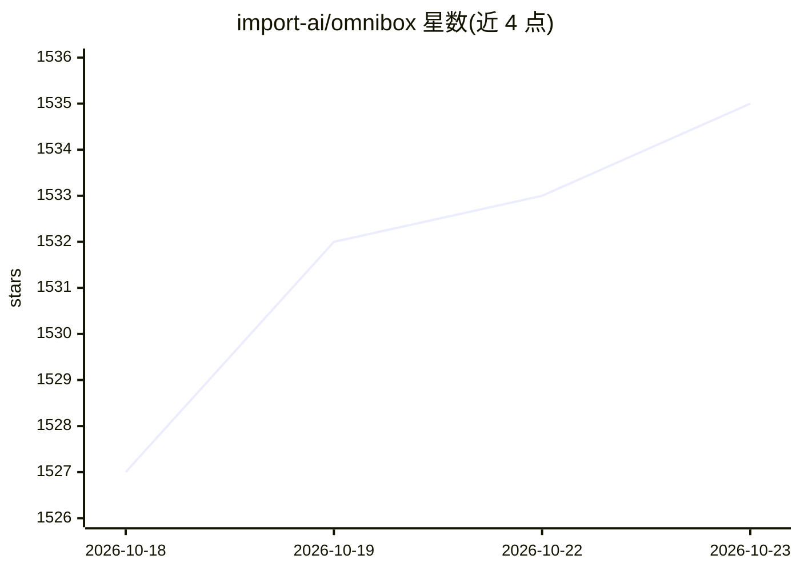

# import-ai/omnibox

⭐ 1,535 · Python · Apache-2.0 · 推送 2026-10-22 · [GitHub](https://github.com/import-ai/omnibox) · [官网](https://www.omnibox.pro) · 组织维护 · 中文 README

**跨平台一体化 AI 知识库：收集网页/文件，问答与写作**

OmniBox（小黑）是一个跨平台的一体式 AI 知识中枢，由 web、backend、wizard、浏览器扩展等多模块组成。核心功能包括：通过浏览器扩展保存网页正文；上传 PDF/Word/PPT/MP3 等文件并完成端到端解析与索引；Markdown 编辑与渲染（支持公式、思维导图、流程图等）；基于互联网与本地数据库的问答和写作；iOS 端快速记录（语音/文字）与文件分享；微信机器人多格式内容存入。提供用户与团队系统、权限、多租户、多语言等。支持在线服务 omnibox.pro，也可 git clone 源码本地部署开发。

## 筛选速览

| 维度 | 判定 | 备注 |
|---|---|---|
| AI 角色 | `ai-native` | 本体是模型或模型工具 |
| 许可风险 | `permissive` | Apache-2.0 |
| 部署形态 | `None` |  |
| 模型依赖 | — | README 未给出锁定关系 |
| 硬件要求 | — | 无带数字的原话,不猜 |
| 安装摩擦 | `low` | 无编译、无系统依赖或容器化 |
| 成熟度 | — | 结构信号不足 |

## 能力要点

- 浏览器扩展保存网页正文
- PDF/Word/PPT/MP3 等文件上传解析与索引
- 基于互联网与本地数据库的问答与写作
- iOS 速记与微信机器人多格式内容收集

## 适用场景

- 把网页、文件、微信消息统一收集到个人知识库
- 对本地资料进行问答与写作
- 团队共享知识库与权限管理

## 场景标签

`知识库管理` `文档问答` `AI 写作` · 领域:内容生成

## 证据(README 行号)

> L18: OmniBox (小黑) is a simple, cross-platform, all-in-one AI knowledge hub. All you need to do is collect, then ask.
> L25: 4. Q&A and writing based on both Internet and local databases.

## 星数曲线

2026-10-18 1,527 → 2026-10-23 1,535（+8）

---
*卡片 v1 · prompt 1.4 · 生成 2026-10-21 · 置信度 high · 依据 README sha `063714027a41` · [字段定义](../../DATASET.md)*
