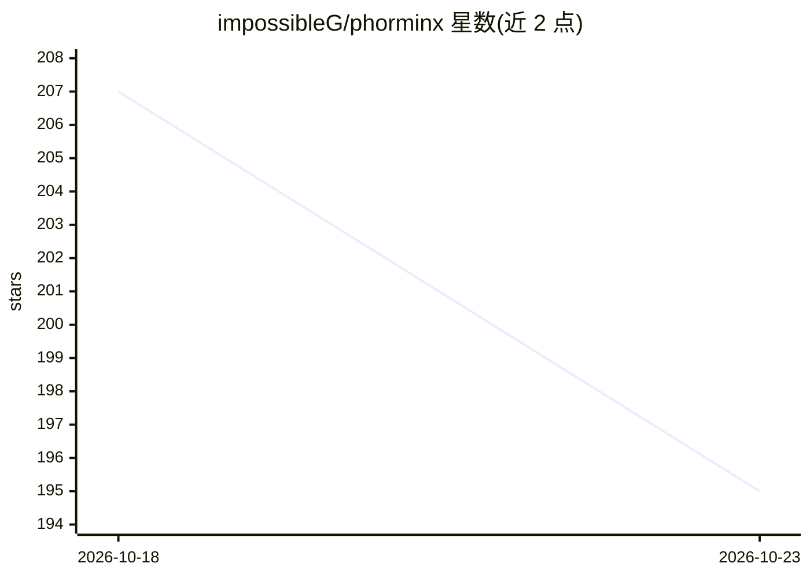

# impossibleG/phorminx

⭐ 195 · Rust · MIT · 推送 2026-10-22 · [GitHub](https://github.com/impossibleG/phorminx) · [官网](phorminx.net) · 个人维护

**Windows 本地优先的语音听写与会议转录应用**

面向 Windows 10/11 的桌面应用：Ctrl+Alt+Space 触发本地听写，Instant 模式用 Vosk、Accurate 模式用 Whisper（可选 Vulkan GPU），可由本地 Ollama 模型做多轮格式化；会议模式同时采集麦克风与电脑音频做双语转录，并附带基于转录内容的问答助手。另有研究笔记（Investigations，本地 OCR + 引用回答）、提示词库、本地语义搜索与基于 Tor 的点对点消息。Ollama 为可选组件，无它时听写仍可用。安装包未做 Authenticode 签名，自述为 alpha 阶段。

## 筛选速览

| 维度 | 判定 | 备注 |
|---|---|---|
| AI 角色 | `ai-native` | 本体是模型或模型工具 |
| 许可风险 | `permissive` | MIT |
| 部署形态 | `None` |  |
| 模型依赖 | local-ok | 支持本地模型 |
| 硬件要求 | — | 无带数字的原话,不猜 |
| 安装摩擦 | `low` | 无编译、无系统依赖或容器化 |
| 成熟度 | `idea` | |

## 能力要点

- 本地语音识别：Vosk（快速）/ Whisper（可选 Vulkan GPU）双模式
- 本地 Ollama 模型多轮格式化与会议实时翻译
- 研究笔记：OCR、时间线/图表视图与带引用的助手回答
- 基于 Tor（Arti）的点对点消息，默认关闭

## 适用场景

- 用语音听写并自动格式化为可检索文本
- 会议双方音频的本地转录与实时翻译
- 围绕一个问题聚合文本/截图/链接做研究笔记

## 场景标签

`语音识别` `知识库管理` `语义搜索` `OCR` · 领域:知识与检索

## 证据(README 行号)

> L7:  Local-first dictation, meetings and research notes for Windows.
> L36: Dictation: press Ctrl+Alt+Space, speak, the speech is recognized locally, optionally formatted by a local Ollama mo
> L68: Both sides of the call, transcribed and translated: your microphone and computer audio go to two local recognizers,

## 星数曲线

2026-10-18 207 → 2026-10-23 195（-12）

---
*卡片 v1 · prompt 1.4 · 生成 2026-10-22 · 置信度 high · 依据 README sha `14cd3efc3264` · [字段定义](../../DATASET.md)*
