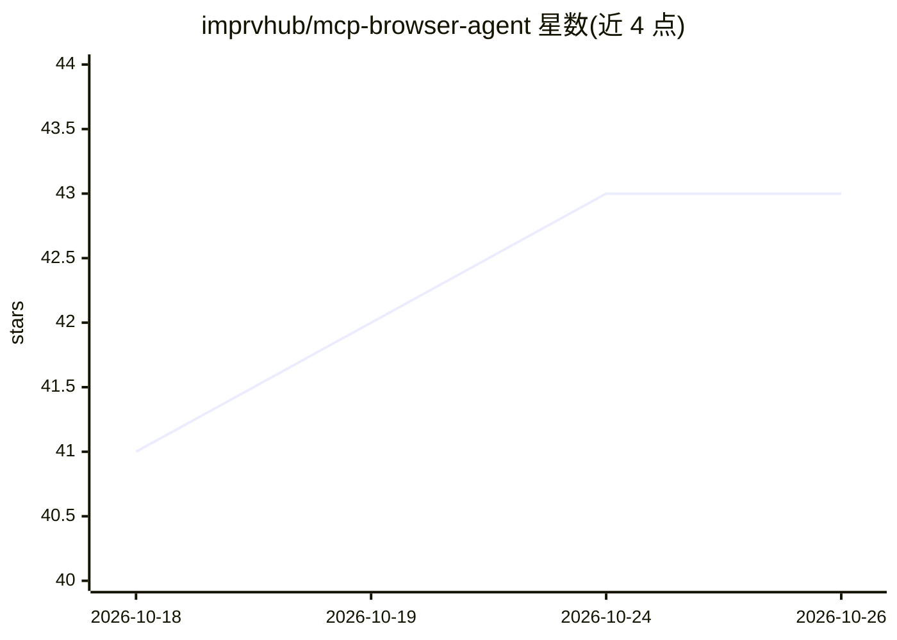

# imprvhub/mcp-browser-agent

⭐ 43 · TypeScript · MPL-2.0 · 推送 2026-10-21 · [GitHub](https://github.com/imprvhub/mcp-browser-agent) · 个人维护

**为 Claude Desktop 提供自主浏览器自动化的 MCP 服务器**

基于 Model Context Protocol 与 Playwright 的 MCP 服务器，使 Claude Desktop 能驱动有头浏览器：导航 URL、截图、点击/填充/悬停/选择等 DOM 操作、执行 JavaScript 并捕获控制台日志；另提供 GET/POST/PUT/PATCH/DELETE 的 HTTP 请求工具。浏览器会话跨命令保持状态，支持 Chrome/Firefox/Edge/WebKit（默认 Chrome，缺失时回退 Playwright 的 Chromium）。通过 Smithery、git clone+npm 构建（需 Node.js 20+）安装，写入 claude_desktop_config.json 后由 Claude Desktop 自动启动；浏览器类型可经配置文件、命令行参数或环境变量指定。

## 筛选速览

| 维度 | 判定 | 备注 |
|---|---|---|
| AI 角色 | `ai-ecosystem` | LLM/agent 周边工具 |
| 许可风险 | `permissive` | MPL-2.0 |
| 部署形态 | `library` | 以包/库形式分发 |
| 模型依赖 | locked-api |  |
| 硬件要求 | — | 无带数字的原话,不猜 |
| 安装摩擦 | `low` | 无编译、无系统依赖或容器化 |
| 成熟度 | — | 结构信号不足 |

## 能力要点

- 7 个浏览器工具（导航/截图/点击/填充/选择/悬停/执行 JS）与 5 个 HTTP 请求工具
- 跨命令保持有头浏览器会话状态，支持链式多步操作
- 通过 MCP resource 暴露浏览器控制台日志与截图
- 支持 Chrome/Firefox/Edge/WebKit 四种浏览器并可按环境变量调整视口等参数

## 适用场景

- 让 Claude Desktop 代替我完成网页搜索、表单填写与登录等操作
- 通过自然语言驱动浏览器执行多步任务并截图留档
- 让 agent 直接调用 API 并处理返回数据

## 场景标签

`浏览器自动化` · 领域:效率与自动化

## 证据(README 行号)

> L6:  A powerful Model Context Protocol (MCP) integration that provides Claude Desktop with autonomous browser automation
> L244: MCP Browser Agent is built on the Model Context Protocol, enabling Claude to interact with a headful browser throu
> L249:  - Establishes communication with Claude through the stdio transport

## 星数曲线

2026-10-18 41 → 2026-10-26 43（+2）

---
*卡片 v1 · prompt 1.4 · 生成 2026-10-25 · 置信度 high · 依据 README sha `b44cf7900cba` · [字段定义](../../DATASET.md)*
