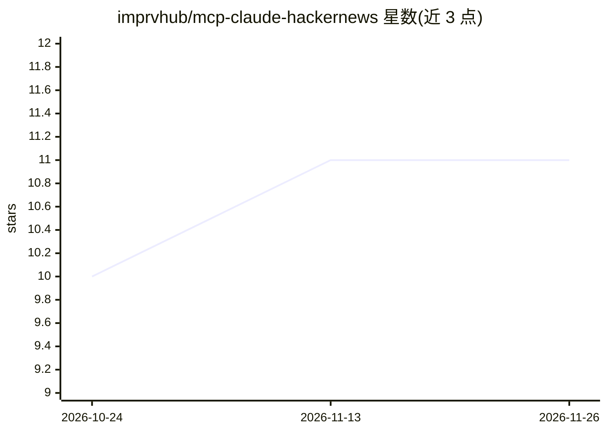

# imprvhub/mcp-claude-hackernews

⭐ 11 · TypeScript · MPL-2.0 · 推送 2026-10-21 · [GitHub](https://github.com/imprvhub/mcp-claude-hackernews) · 个人维护

**让 Claude Desktop 通过 MCP 读取 Hacker News 的服务器**

基于 Model Context Protocol 的服务器集成，使 Claude Desktop 能获取 Hacker News 内容：提供 6 个工具（最新/热门/最佳故事、关键词搜索、故事详情、评论读取），搜索走 Algolia HN Search API，评论有数量上限防止上下文溢出，并对 HN 内容做格式清理与 HTML 实体解码；支持自然语言查询与内容翻译请求。需 Node.js 20+，可经 Smithery 安装或源码构建，由 Claude Desktop 配置文件自动启动或手动运行。

## 筛选速览

| 维度 | 判定 | 备注 |
|---|---|---|
| AI 角色 | `ai-ecosystem` | LLM/agent 周边工具 |
| 许可风险 | `permissive` | MPL-2.0 |
| 部署形态 | `desktop` | 安装包/桌面程序 |
| 模型依赖 | — | README 未给出锁定关系 |
| 硬件要求 | — | 无带数字的原话,不猜 |
| 安装摩擦 | `low` | 无编译、无系统依赖或容器化 |
| 成熟度 | — | 结构信号不足 |

## 能力要点

- 6 个 MCP 工具：hn_latest/hn_top/hn_best/hn_search/hn_story/hn_comments
- 故事数量限制 1-50，评论默认 20 条防止上下文溢出
- 支持自然语言查询及将 HN 内容翻译为多语言
- 支持 Smithery CLI 安装或源码构建，可随 Claude Desktop 自启

## 适用场景

- 在 Claude 对话中浏览和搜索 Hacker News 故事与评论
- 让 Claude 抓取 HN 技术文章并翻译成其他语言
- 追踪 Hacker News 上的热门技术讨论

## 场景标签

`聊天机器人` · 领域:对话与助手

## 证据(README 行号)

> L9:  An integration that allows Claude Desktop to interact with Hacker News using the Model Context Protocol (MCP).
> L122: The Hacker News MCP provides **6 specialized tools** for different functions:

## 星数曲线

2026-10-24 10 → 2026-11-26 11（+1）

---
*卡片 v1 · prompt 1.4 · 生成 2026-11-18 · 置信度 high · 依据 README sha `9c5aca585d87` · [字段定义](../../DATASET.md)*
