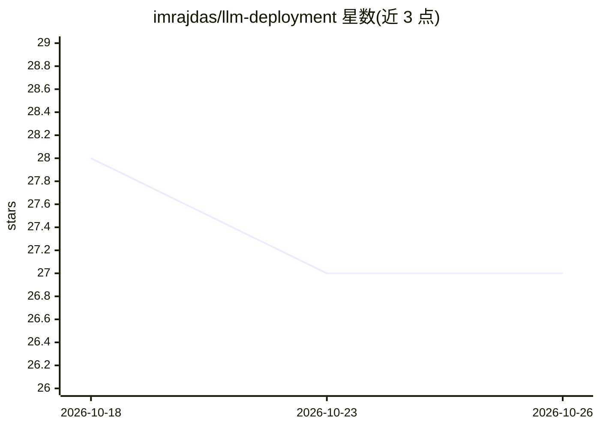

# imrajdas/llm-deployment

⭐ 27 · Shell · Apache-2.0 · 推送 2026-10-20 · [GitHub](https://github.com/imrajdas/llm-deployment) · 个人维护

**在 Azure+JarvisLabs GPU 的 K8s 上部署 vLLM 并配 Streamlit 聊天界面**

一套自托管 LLM 部署方案：Azure Ubuntu VM 运行 Kubernetes 控制平面，JarvisLabs GPU VM 作为工作节点加入集群（WireGuard/Tailscale/NetBird 组网），用公共 vllm/vllm-openai 镜像运行模型，前端为自行构建的 Streamlit 镜像，通过 OpenAI 兼容 API 与聊天页访问。模型、GPU 与上下文长度在 manifest.yaml 中配置，提供 GPU 暂停/恢复/销毁脚本以控制计费，暂停期间保留磁盘与已下载模型。从零搭建需手动完成 WireGuard 配置、kubeadm 初始化与节点加入。面向有云账号、愿意自行运维的开发者。

## 筛选速览

| 维度 | 判定 | 备注 |
|---|---|---|
| AI 角色 | `ai-ecosystem` | LLM/agent 周边工具 |
| 许可风险 | `permissive` | Apache-2.0 |
| 部署形态 | `self-host` | docker 或自建部署 |
| 模型依赖 | local-ok | 支持本地模型 |
| 硬件要求 | — | 无带数字的原话,不猜 |
| 安装摩擦 | `low` | 无编译、无系统依赖或容器化 |
| 成熟度 | — | 结构信号不足 |

## 能力要点

- Azure 控制平面 + JarvisLabs GPU 节点的双 VM Kubernetes 架构
- GPU 暂停/恢复脚本控制计费，暂停保留磁盘与已下载模型
- OpenAI 兼容 API（集群内 http://vllm.llm.svc.cluster.local:8000/v1）
- 模型/GPU/上下文长度通过 manifest.yaml 配置，支持 HF_TOKEN 门控模型

## 适用场景

- 在租用 GPU 上自建可随时暂停计费的聊天模型服务
- 用 kubectl 管理自己的 vLLM 推理集群
- 通过 Streamlit 页面与开源模型对话

## 场景标签

`推理引擎` `聊天机器人` · 领域:对话与助手

## 证据(README 行号)

> L3: Chat with an open model. vLLM runs on a JarvisLabs GPU VM. The Streamlit page runs on an Azure VM.
> L61: `UI_IMAGE` is the Streamlit image the cluster can run. vLLM uses the public `vllm/vllm-openai` image and is schedul
> L65: Inside the cluster the OpenAI-compatible API is `http://vllm.llm.svc.cluster.local:8000/v1`.

## 星数曲线

2026-10-18 28 → 2026-10-26 27（-1）

---
*卡片 v1 · prompt 1.4 · 生成 2026-10-26 · 置信度 mid · 依据 README sha `34b57a26b5cf` · [字段定义](../../DATASET.md)*
